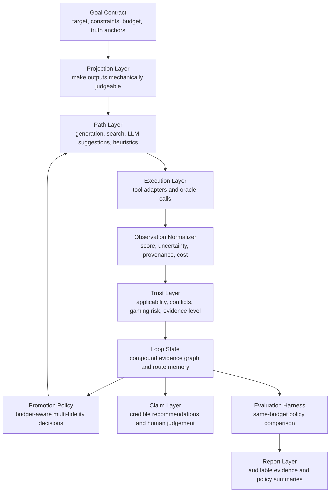

# Closed-Loop Drug Discovery Harness

## Research Object

This project treats closed-loop drug discovery as:

> a budgeted, multi-fidelity decision process over evolving evidence states,
> constrained by oracle trust gaps and credibility-aware evaluation.

The object of study is not whether an agent can call chemistry tools. The object
is whether a loop can autonomously explore while preserving scientific
credibility when its available oracles are partial, noisy, expensive, and
gameable.

## Layered Architecture

## Layer Contracts

### 1. Goal Contract

Defines the task before the loop begins:

- target structure or target family;
- seed ligands or known actives;
- hard constraints such as reactive groups, charge, molecular weight, or assay;
- budget for cheap filters, docking, ADMET, high-fidelity calls, human review,
  and experiment;
- final truth anchors, such as wet-lab assay or expert medicinal chemistry
  review.

This layer prevents the system from silently changing the definition of progress.

### 2. Projection Layer

The open goal "find a good drug candidate" is not directly loopable. The
projection layer restricts and normalizes outputs into judgeable representations:

- canonical SMILES;
- molecular graph and scaffold identity;
- conformer or protein-ligand pose;
- interaction fingerprint;
- ADMET endpoint vector;
- synthesis or retrosynthesis status;
- assay readout when available.

This is where open-ended discovery is shaped into an oracle-readable form.

### 3. Path Layer

This layer decides what to try. It may use generators, LLMs, library search,
scaffold hopping, R-group enumeration, active learning, or human suggestions.

The path layer is allowed to be heuristic. It is not allowed to write claims.

### 4. Execution Layer

All concrete tools enter as adapters:

- cheap chemistry filters;
- ADMET predictors;
- docking and rescoring;
- free-energy surrogates;
- synthesis checks;
- human review;
- wet-lab assays.

Adapters return observations. They do not decide scientific credibility on their
own. Adapter observations must carry provenance sufficient for TrustGate and
replay audit.

### 5. Trust Layer

The trust layer checks whether an observation is usable as evidence:

- Is the input inside the oracle's applicability domain?
- Is the oracle independent enough from the generator or previous scorer?
- Does this observation conflict with other evidence?
- Is the score easy to game?
- Is provenance complete?
- Does this claim need promotion to a higher-fidelity oracle?

The output is not just pass/fail. It is an evidence status and a set of
credibility flags.

### 6. Loop State

The state is an evidence graph, not a molecule table. It stores:

- compound provenance and parentage;
- scaffold routes;
- oracle observations;
- uncertainty and conflicts;
- rejected hypotheses;
- budget spent;
- human preferences;
- route-level memory.

Every compound is a traceable evidence chain.

### 7. Promotion Policy

The central policy question:

> Which candidate, scaffold route, or hypothesis deserves the next expensive
> oracle call?

Promotion is not simply top-score selection. It should account for expected
credible improvement, cost, uncertainty, diversity, conflict resolution, and
oracle trust gap.

Initial comparable policies:

- fixed cascade;
- greedy score;
- random promotion;
- uncertainty-aware promotion;
- Pareto expected improvement;
- cost-normalized credible improvement;
- human-in-the-loop policy.

### 8. Claim Layer

Claims are made only from qualified evidence. If the final recommendation
requires multi-objective judgement without a clean objective oracle, the human
is explicitly placed in the truth position.

Every recommendation should include:

- evidence summary;
- unresolved conflicts;
- oracle levels used;
- known failure risks;
- budget spent;
- human judgement, if used.

### 9. Evaluation Harness

The harness evaluates loops under equal budgets. Useful metrics include:

- cost to first credible hit;
- same-budget enrichment;
- Pareto hypervolume;
- ADMET pass rate;
- scaffold diversity;
- high-fidelity waste rate;
- oracle disagreement rate;
- false-positive suppression;
- credible-hit rate;
- external validation rate.

The evaluation target is not top proxy score. It is credible discovery efficiency.

### 10. Report Layer

The report layer turns the recorded campaign into a readable and machine-ready
artifact:

- compound evidence tickets;
- claim protocol status;
- missing evidence;
- policy replay metrics;
- budgeted action summaries.

It is intentionally read-only. It summarizes the loop; it does not make the loop
more permissive.

## Design Red Lines

- Do not treat a verifier as an oracle.
- Do not optimize long-term against self-consistency, committee agreement, or
  LLM judgement as if they were truth.
- Do not let path-layer tools write trust-layer claims.
- Do not delete failed or rejected evidence; failures are part of the loop state.
- Do not collapse multi-objective judgement into a fake scalar objective unless
  the scalar has a declared truth anchor.
