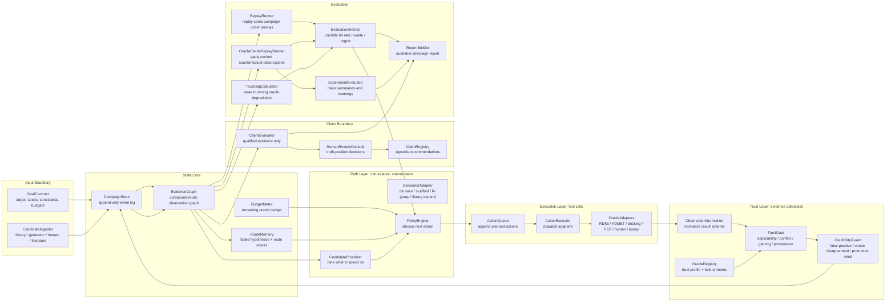

# Component Architecture

This document turns the broad loop shape into concrete components that can be
implemented and tested.

## Component Diagram



## Runtime Spine

The concrete runtime loop is:

```text
GoalContract
  -> CandidateIngestor
  -> CampaignStore
  -> EvidenceGraph
  -> CandidatePrioritizer
  -> PolicyEngine
  -> ActionQueue
  -> ActionExecutor
  -> OracleAdapter
  -> ObservationNormalizer
  -> TrustGate
  -> CampaignStore
  -> EvidenceGraph
  -> PromotionPolicy or ClaimEvaluator
```

The system moves by appending events. No component mutates scientific evidence in
place.

## Components

## Minimal Trust Protocols

The architecture depends on four small protocols rather than a large governance
system:

- `OracleAnchorSpec`: declares what each oracle borrows credibility from.
- `EvidenceLevelProtocol`: maps observations to evidence tiers and claim
  permissions.
- `TrustGapMonitor`: measures reversal, conflict, and waste when weak oracles
  are checked by stronger oracles.
- `ClaimProtocol`: states what evidence is required before the system can make a
  triage, credible-hit, experiment-ready, or human-signed claim.

See `docs/TRUST_PROTOCOLS.md`.

### 1. GoalContract

Defines one campaign.

Inputs:

- target structure or target family;
- known ligands or seed molecules;
- hard filters and desired property ranges;
- budgets for cheap, medium, high-fidelity, human, and experiment actions;
- final truth anchors.

Outputs:

- immutable campaign configuration;
- budget envelope;
- declared claim criteria.

Hard rule:

- If a metric is not declared here or admitted later by a human truth-position
  decision, it cannot silently become the optimization target.

### 2. CandidateIngestor

Normalizes incoming candidates.

Sources:

- known active library;
- generated molecules;
- scaffold/R-group enumeration;
- literature molecules;
- human-designed molecules.

Outputs:

- `CandidateIngested` events;
- canonical molecule identifiers;
- source provenance.

It does not score or reject candidates. Rejection happens through observations.

### 3. CampaignStore

Append-only campaign ledger.

Stores:

- candidate events;
- actions requested;
- observations returned;
- trust-gate decisions;
- budget events;
- human decisions;
- final claims.

This is the drug-loop analogue of the alpha ledger in the CALYPSO flow.

Hard rule:

- Failed, rejected, conflicted, and out-of-domain observations are stored. They
  are negative evidence, not trash.

### 4. EvidenceGraph

Materialized view over the event log.

Nodes:

- campaign;
- target;
- route/scaffold hypothesis;
- compound;
- action;
- observation;
- oracle;
- claim.

Edges:

- generated-from;
- belongs-to-route;
- evaluated-by;
- conflicts-with;
- promoted-to;
- rejected-because;
- supports-claim.

This is the live loop state used by policy and claim components.

### 5. OracleRegistry

Registry of all usable oracles and verifier-like tools.

Each oracle has:

- kind;
- anchor specification;
- cost and latency;
- fidelity class;
- applicability domain;
- known failure modes;
- generator independence;
- gameability;
- external anchors;
- output schema.

Examples:

```yaml
name: CarsiDock
kind: docking
fidelity: medium_high
cost: 5
gameability: high
failure_modes:
  - pose_artifact
  - scoring_bias
  - strained_ligand
external_anchors:
  - crystal_pose_recovery
  - assay_enrichment
anchors:
  - name: crystal_pose_recovery
    anchor_type: retrospective_validation
    validation_basis: known_pose_recovery
    known_gap: pose_recovery_is_not_affinity
```

Hard rule:

- Tool adapters cannot enter execution until the corresponding oracle profile
  exists.

### 6. CandidatePrioritizer

Chooses which candidates or routes are worth considering next.

Inputs:

- EvidenceGraph;
- remaining budget;
- route memory;
- optional human preference;
- optional LLM or heuristic suggestion.

Outputs:

- ranked candidates/routes;
- reasons;
- not actions.

This component is path-layer only. It may be heuristic and replaceable.

### 7. PolicyEngine

Chooses concrete next actions.

Inputs:

- ranked candidates;
- EvidenceGraph;
- BudgetMeter;
- OracleRegistry;
- current policy configuration.

Outputs:

- `ActionPlanned` events.

Supported policy families:

- fixed cascade;
- greedy score;
- random promotion;
- uncertainty-aware promotion;
- conflict-resolution promotion;
- cost-normalized expected credible improvement;
- trust-gap-aware expected credible improvement;
- human-in-the-loop promotion.

Core decision:

```text
which subject gets which next oracle call, and why this cost is justified
```

Current implementation:

- `FixedCascadePolicy`;
- `GreedyProxyPolicy`;
- `TrustAwarePolicy`;
- `TrustGapAwarePolicy`.

`TrustGapAwarePolicy` discounts a weak-oracle promotion by recorded reversal,
conflict, and waste against stronger oracles. This prevents the loop from
continuing to chase a proxy oracle that has already shown poor survival under
promotion.

### 8. ActionQueue

Durable queue of planned actions.

Action examples:

- filter compounds;
- predict ADMET;
- dock;
- rescore;
- run free-energy surrogate;
- check synthesis;
- request human review;
- request assay.

Hard rule:

- Every action must point to a policy decision or a human decision.

### 9. ActionExecutor

Runs tool adapters.

Responsibilities:

- load inputs;
- call adapter;
- capture stdout/stderr/files/API response;
- record runtime failure;
- return raw observation payload.

It is not allowed to decide whether the result is scientifically credible.

### 10. OracleAdapters

Adapter boundary for concrete tools.

Initial adapter types:

- `DeterministicChemFilterAdapter` (current local L0 adapter);
- `ADMETAdapter`;
- `DockingAdapter`;
- `RescoringAdapter`;
- `FreeEnergyAdapter`;
- `SynthesisAdapter`;
- `HumanReviewAdapter`;
- `AssayAdapter`.

All adapters return observations with explicit provenance, adapter identity,
ruleset or model version, applicability domain, and failed-check details where
available.

### 11. ObservationNormalizer

Converts adapter outputs into the common observation schema.

Adds:

- subject id;
- oracle name and version;
- normalized metrics;
- uncertainty if available;
- cost spent;
- provenance;
- raw payload pointer.

It does not qualify the evidence.

### 12. TrustGate

Alpha-to-beta equivalent for drug evidence.

Checks:

- applicability domain;
- provenance completeness;
- output validity;
- known failure modes;
- minimum evidence requirements;
- contradiction with stronger observations;
- whether this observation can support the next claim level.

Outputs:

- `ObservationQualified`;
- `ObservationRejected`;
- `ObservationConflicted`;
- `NeedsPromotion`.

This is the main scientific credibility boundary.

TrustGate must assign an evidence tier, not only a pass/fail status. A docking
observation may be qualified as `L3_BINDING_PROXY`; it does not automatically
support an `experiment_ready` claim.

### 13. CredibilityGuard

Runs cross-observation checks that a single oracle cannot see.

Examples:

- docking score good but ADMET unacceptable;
- docking score good but pose quality suspicious;
- same scaffold repeatedly games one score;
- cheap oracle and expensive oracle systematically disagree;
- generated molecules leave the oracle applicability domain;
- human rejects a pattern that the model keeps exploiting.

Outputs:

- credibility flags;
- route penalties;
- promotion requests;
- abstention signals.

### 14. BudgetMeter

Tracks spent and remaining budget.

Budget dimensions:

- cheap calls;
- medium calls;
- high-fidelity calls;
- human review slots;
- experiment slots;
- compute units;
- wall-clock latency if needed.

Policy quality is always judged under this budget.

### 15. RouteMemory

Stores route-level learning.

Route means a scaffold, binding hypothesis, chemotype, or medicinal chemistry
direction.

Stores:

- positive evidence;
- negative evidence;
- repeated failure modes;
- oracle conflicts;
- human notes;
- whether to exploit, pause, or terminate the route.

This is what makes the loop more than independent molecule scoring.

### 16. ClaimEvaluator

Builds candidate recommendations from qualified evidence only.

Inputs:

- EvidenceGraph;
- declared claim criteria;
- TrustGate status;
- unresolved conflicts;
- human review if required.

Outputs:

- draft claim;
- missing evidence list;
- explicit uncertainty;
- human truth-position request if needed.

ClaimEvaluator uses declared `ClaimProtocol` objects. It should not invent a new
claim threshold during a campaign.

### 17. HumanReviewConsole

Explicit human truth-position boundary.

Used when:

- final objective has no clean oracle;
- multi-objective tradeoff is claim-level;
- route termination has strategic cost;
- experimental spend is being committed;
- a rescue or exception is requested.

Human review is stored as evidence with provenance, not as an invisible override.

### 18. ClaimRegistry

Stores signable recommendations.

Each claim includes:

- compound ids;
- route hypothesis;
- supporting qualified observations;
- conflicts and abstentions;
- budget spent;
- human decisions;
- final recommendation level.

### 19. ReplayRunner

Replays a campaign under alternative policies.

Purpose:

- compare fixed cascade, greedy, uncertainty-aware, and budget-aware policies;
- compute same-budget outcomes;
- isolate whether a policy improves credible discovery rather than proxy score.

### 20. EvaluationMetrics

### 20.1. OracleCacheReplayRunner

Applies recorded oracle observations as an explicit cache.

Purpose:

- evaluate policies from the same initial state;
- reveal missing counterfactual observations;
- trace each replay round from planned action to cached observation to
  TrustGate result;
- avoid pretending that unrun oracle calls have known results.

Hard rule:

- if the cache does not contain the observation for a planned action, the replay
  records a missing counterfactual instead of fabricating a result.

### 20.2. TrustGapCalculator

Measures degradation from weak-oracle positives to stronger-oracle checks.

Counts:

- promoted weak positives with stronger checks;
- reversals;
- conflicts;
- high-fidelity waste.

Hard rule:

- negative high-fidelity or human-review evidence must be allowed to block
  downstream claims.

### 20.3. ExperimentEvaluator

Summarizes replay traces into policy-comparison rows.

Outputs:

- action count;
- planned action count;
- applied observation count;
- missing observation count;
- missing-counterfactual rate;
- trace coverage;
- terminal stop reason;
- claim rates;
- warnings.

Hard rule:

- ExperimentEvaluator does not declare a winner. It exposes trace quality and
  missing evidence so human interpretation remains proportional to evidence.

### 20.4. EvaluationMetrics

Computes loop-level metrics:

- cost to first credible hit;
- same-budget enrichment;
- Pareto hypervolume;
- ADMET pass rate;
- scaffold diversity;
- high-fidelity waste rate;
- oracle disagreement rate;
- false-positive suppression;
- credible-hit rate;
- external validation rate when available.

The minimal trust-gap metrics are:

- reversal rate;
- conflict rate;
- high-fidelity waste rate.

These are the loop's direct readings of whether proxy oracles are still
trustworthy enough to drive promotion.

### 21. ReportBuilder

Builds an auditable campaign report from recorded state.

Inputs:

- LoopState;
- ClaimEvaluator outputs;
- MetricsCalculator outputs;
- optional ReplayRunner outputs.

Outputs:

- per-compound evidence ticket summaries;
- strongest satisfied claim level;
- missing claim evidence;
- policy replay summaries;
- JSON-ready campaign report payload.

Hard rule:

- ReportBuilder is read-only. It cannot upgrade claims, suppress TrustGate
  failures, or fill in missing counterfactual oracle results.

## Data Ownership

| Data | Writer | Reader |
|---|---|---|
| Goal contract | human / campaign setup | all components |
| Candidate events | CandidateIngestor | EvidenceGraph, PolicyEngine |
| Oracle profile | human / registry maintainer | PolicyEngine, TrustGate |
| Planned action | PolicyEngine / human | ActionExecutor |
| Raw observation | ActionExecutor | ObservationNormalizer |
| Normalized observation | ObservationNormalizer | TrustGate |
| Qualified evidence | TrustGate | EvidenceGraph, ClaimEvaluator |
| Credibility flags | CredibilityGuard | PolicyEngine, ClaimEvaluator |
| Promotion decision | PolicyEngine | ActionQueue, EvaluationHarness |
| Final claim | ClaimEvaluator + human if needed | downstream users |
| Campaign report | ReportBuilder | human / downstream analysis |

## Event Types

Minimal event vocabulary:

```text
CampaignCreated
CandidateIngested
RouteOpened
ActionPlanned
ActionStarted
ActionCompleted
ActionFailed
ObservationRawRecorded
ObservationNormalized
ObservationQualified
ObservationRejected
ObservationConflicted
PromotionRequested
PromotionApproved
RoutePaused
RouteTerminated
HumanDecisionRecorded
ClaimDrafted
ClaimSigned
```

## First Concrete Loop

The first concrete drug loop should be:

```text
candidate ingestion
  -> cheap chemistry filters
  -> ADMET prediction
  -> docking
  -> trust qualification
  -> promotion decision
  -> higher-fidelity rescoring or human review
  -> qualified recommendation
```

The important development object is not the choice of RDKit, ADMETlab, or
CarsiDock. The important object is whether each observation can cross the trust
gate and how that changes the next promotion decision.
