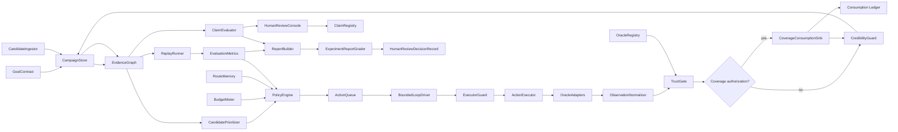
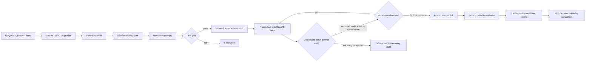
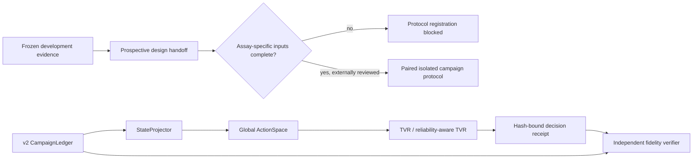
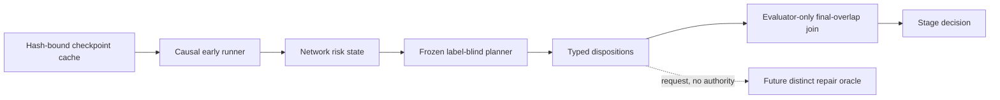

# Current Architecture

## Core Thesis

The project is a loop-engineering harness for drug discovery. Its central job is
not to call many tools, but to control how evidence moves from exploratory
signals into claims.

The loop is organized around this rule:

> Path decisions may be heuristic. Evidence admission must be explicit. Claims
> must be tiered and traceable.

## Component View



## Runtime Spine

```text
campaign setup
  -> candidate ingestion
  -> raw event ledger
  -> evidence graph
  -> prioritization
  -> policy decision
  -> action queue
  -> tool execution
  -> observation normalization
  -> trust gate result
  -> state update
  -> coverage consumption record (approved coverage actions only)
  -> next promotion or claim
```

For a coverage-authorized action, the runtime has two independent gates:

```text
LedgerBackedCoverageApprovalGate -> executor -> TrustGate -> CoverageConsumptionSink
```

The first is a permission check before execution. It reloads all prior consumed
request ids for the exact plan and approval from the same durable ledger before
each action, so a second request in the same serial driver round is denied
before another executor call. The second writes the single-use authorization
receipt only after the returned observation and its TrustGate ticket exist. A
missing sink blocks the action before execution. A sink write failure stops the
run with
`coverage_consumption_persistence_failed`; the admitted observation remains in
the failed-run trace for diagnosis, but that run is not interpretable evidence
for policy comparison or claims.

## Current FEP Repair Subloop

The PTP1B risk stage now feeds a concrete paired repair oracle rather than a
generic repair request:



The pilot cannot promote evidence or tune the repair profile. It validates only
that both arms and both thermodynamic legs can run and decode in the qualified
OpenFE environment. The scientific comparison begins only when the frozen 5 ns,
three-repeat task cohort is complete. See `PTP1B_PAIRED_REPAIR_ORACLE.md`.

The full scheduler is now authorized and its first four-task batch is running;
it has not yet produced a terminal full outcome. Its nine batches use a
predeclared balanced order. Continuation sees only execution status, elapsed
cost, and artifact integrity; scientific metrics are stored in separate
outcomes and remain unavailable to scheduler state.

An advisory liveness audit can verify the WSL runner PID and command identity
for an unresolved start. It cannot continue, recover, terminate, reorder, or
interpret a task.

A detached 15-minute operational monitor records only liveness and artifact
counts while batch 0 runs. It has no access to scientific metric values and no
execution or recovery authority.

At scheduler exit, an independent batch-commit auditor verifies the exact
four-task prefix, start/receipt/outcome hash chain, task identity, serialized
timestamps, log and raw-result hashes, success state, and compute budget. It
hashes outcome and raw-result files without parsing them. Passing this audit
establishes continuation eligibility under the existing frozen authorization;
the auditor itself cannot launch the next batch or grant execution authority.

The metric-blind campaign controller was frozen while the first task was active
and before any terminal full outcome. After the accepted batch-0 commit, it
invokes exactly one frozen batch at a time, requires a fresh accepted commit,
and then continues under the original 36-task authorization. It cannot retry,
resume, recover, retune, reorder, or use scientific metrics. A nonaccepted
commit halts the campaign. Only the accepted batch-8 commit can invoke the
already frozen full-cohort finalizer.

A separate 15-minute campaign heartbeat follows the long-lived Windows wrapper
after the batch-0 monitor exits. It records process liveness and counts of
starts, receipts, outcomes, commit artifacts, and the final decision artifact.
It does not parse commit or outcome payloads and cannot influence continuation.

`FEPRepairCampaignState` is a rebuildable read-only project-state projection,
not a molecule list. It combines task and batch progress, accepted commit chain,
compute budget, stop state, evidence-release readiness, and the next legal
transition. Outcome values remain sealed. The projection is explicitly excluded
from controller inputs and carries no execution, continuation, or recovery
authority.

The primary paired gate remains a development decision, not a significance
test. A separately frozen post-decision credibility companion reports paired
rescue versus harm counts, per-edge diagnostics, leave-one-edge-out behavior,
and overlap-threshold sensitivity. It declares three selected edges as the
independent scientific units; the 18 edge-by-leg-by-repeat pairs are correlated
technical units. Its exact paired sign value is descriptive only, no cluster
confidence interval is claimed from three edges, and it cannot change the
primary decision or upgrade the claim.

A separately frozen release lock sits before `FepPairedRepairEvaluator`. It
requires 36 successful terminal receipts and refuses partial-cohort release.
GO maps only to untouched-target confirmation; NO-GO rejects this repair
profile. Neither mapping upgrades molecular or accuracy claims.

## Prospective V2 Policy Bridge

The Jensen promotion curve and reliability stress ablation now feed a separate
v2 prospective policy contract. This contract does not alter the v1 prospective
receipt or its candidate-episode study assumptions.



TVR choices are coupled through one posterior and budget. Therefore the
prospective scientific unit is an independent target/cohort campaign replicate,
not an individual molecule decision. The two arms must use identical frozen
starting pools and budgets but isolated observation histories. The current
handoff is ready for assay-specific design inputs; it grants no execution or
claim authority.

## Layer Boundaries

### Path Layer

Components:

- CandidateIngestor
- CandidatePrioritizer
- GeneratorAdapter
- PolicyEngine
- TableCandidateAdapter

Allowed:

- generate molecules;
- enumerate analogs;
- rank routes;
- propose next actions;
- use heuristic or LLM suggestions.

Not allowed:

- mark evidence as trustworthy;
- create final claims;
- silently change the campaign goal.

### Execution Layer

Components:

- ActionQueue
- BoundedLoopDriver
- ExecutorGuard
- ActionExecutor
- OracleAdapters
- ObservationNormalizer
- TableObservationAdapter
- DeterministicChemFilterAdapter
- LocalCommandExecutor
- run_chem_filter command
- run_composed_campaign command
- run_loop_driver command
- run_command_executor_demo command
- run_command_promotion_experiment command

Allowed:

- execute tools;
- validate action arguments and approval/idempotency requirements before live
  executor calls;
- capture raw payloads;
- normalize output shape;
- record failures.
- emit provenance fields required by TrustGate and audit.

Not allowed:

- decide scientific credibility.

### Trust Layer

Components:

- OracleRegistry
- TrustGate
- CredibilityGuard
- TrustGapMetric

Allowed:

- check oracle anchors;
- check applicability domain;
- assign evidence tier;
- detect conflicts;
- flag gaming risk;
- recommend promotion.

Not allowed:

- spend budget directly;
- override claim protocols.

### State Core

Components:

- CampaignStore
- EvidenceGraph
- BudgetMeter
- RouteMemory

Principle:

> State is evidence history, not a molecule table.

### Claim Boundary

Components:

- ClaimEvaluator
- HumanReviewConsole
- ClaimRegistry

Allowed:

- draft tiered claims;
- request human truth-position decisions;
- sign recommendations with evidence provenance.

Not allowed:

- upgrade claim level without satisfying the protocol.

Current implementation:

- `claims.py` evaluates protocols against admitted TrustGate results.
- It reports missing evidence rather than fabricating a scalar confidence.
- It can treat high trust-gap risk as an unresolved false-positive flag for
  unverified weak-oracle evidence.

## Current Policy Layer

The first policy set is intentionally small:

- `FixedCascadePolicy` plans the next missing step in a fixed evidence cascade.
- `GreedyProxyPolicy` ranks proxy-positive observations by primary score.
- `TrustAwarePolicy` ranks by proxy signal adjusted by local quality,
  applicability, flags, and action cost.
- `TrustGapAwarePolicy` further discounts promotion value when the weak oracle
  has high observed reversal, conflict, or high-fidelity waste against a
  stronger oracle.
- `StagedPromotionPolicy` gives multiple promotion policies the same cheap
  evidence bootstrap before delegating high-fidelity promotion choices. This
  keeps policy comparisons from rewarding a policy merely because it started
  from a different evidence state.

This separation gives the harness a clean ablation path: compare simple cascade,
proxy-aware promotion, and credibility-history-aware promotion under the same
campaign state.

## TrustGate Output

TrustGate produces an evidence admission ticket:

```text
TrustGateResult
  id
  subject_id
  observation_id
  oracle_name
  decision
  evidence_tier
  claim_permission
  applicability
  quality
  conflict
  promotion
  flags
  normalized_signal
  provenance
```

Allowed decisions:

```text
qualified
rejected
conflicted
abstain
needs_promotion
needs_human
```

The result answers:

- Can this observation be admitted as evidence?
- Which evidence tier does it support?
- Which claim levels can it support?
- Is it in the oracle applicability domain?
- Is there a conflict with existing evidence?
- Should the policy promote it to a stronger oracle?

## Coverage Consumption Boundary

`CoverageConsumptionSink` belongs to the authorization audit plane, not the
evidence plane. It stores the exact plan/report binding, approval, action,
observation, TrustGate ticket, budget, and admission outcome. It does not raise
an evidence tier or change a claim permission.

An action carrying either coverage identifier is treated as coverage-scoped and
is fail-closed unless it carries both immutable `coverage_request_id` and
`coverage_approval_id`. Ordinary actions never write to the coverage ledger
merely because the runtime has one configured.

`LedgerBackedCoverageApprovalGate` uses the full matching consumption ledger for
authorization. Compact ledger summaries are hot-state inspection artifacts only
and must never decide whether a single-use request remains executable. The
guarantee is intentionally scoped to the serial local `BoundedLoopDriver`; this
project does not yet claim cross-process or distributed exactly-once execution.

## Minimal Trust Protocols

The current architecture has four hard protocols:

1. OracleAnchorSpec  
   Declares why an oracle is trusted at all.

2. EvidenceTier and EvidenceRequirement  
   Declares what kind of evidence an observation provides.

3. TrustGapMetric  
   Measures how weak oracles degrade when checked by stronger oracles. Metrics
   can be global or scoped to a scaffold.

4. ClaimProtocol  
   Declares what evidence is required before each claim level.

## Current Design Bias

The system favors:

- append-only event history;
- explicit abstention;
- tiered claims;
- budget-relative policy evaluation;
- human truth position where no clean oracle exists;
- weak tools used as path guides, not final truth.
- scaffold-local failure memory before global pessimism when both are available.

The system avoids:

- fake scalar objectives;
- self-judging loops;
- tool output becoming truth by default;
- deleting failed evidence;
- optimizing against internal consistency as if it were truth.

## Current Evaluation Layer

The first evaluation layer is intentionally offline:

- `MetricsCalculator` computes claim rates, TrustGate decision counts, planned
  action cost, high-fidelity action count, human-action count, and trust-gap
  rates from recorded state. It also computes scaffold-aware high-fidelity
  metrics, including repeated scaffold spending, repeated scaffold waste, and
  rescued-scaffold count.
- `TrustGapCalculator` measures how weak-oracle positives survive stronger
  checks, including reversal and high-fidelity waste. It can compute global
  trust gaps or scaffold-local trust gaps.
- `BoundedLoopDriver` runs a single policy/executor loop with explicit budget,
  missing-observation, skipped-observation, invalid-output, TrustGate, and
  coverage-consumption traces. It fails closed when a coverage action has no
  sink or the sink cannot persist its receipt.
- `ExecutorGuard` validates action arguments, approval requirements,
  idempotency keys, and executor errors before external or scarce actions can
  run.
- `LocalCommandExecutor` is the first external-style executor boundary. It runs
  fixed local commands, parses structured observation JSON, and reports
  malformed output, command failure, or timeout as trace status rather than
  scientific evidence.
- `ReplayRunner` runs multiple policies against the same evidence state and
  reports their planned actions and metrics.
- `OracleCacheReplayRunner` starts from an initial state and applies only
  explicitly cached oracle observations. Missing counterfactuals are reported
  as missing, not imputed. It now records per-round traces with planned action
  counts, applied observations, missing observations, stop reasons, cached
  observation ids, and TrustGate decisions. It can also run with a budget limit
  and report budget-limited actions as missing observations with explicit
  reasons. It can refresh trust-gap metrics after each replay round from only
  the evidence already admitted into the replay state.
- `ExperimentEvaluator` converts oracle-cache replay traces into policy
  experiment summaries: missing-counterfactual rate, trace coverage, stop
  reason, action cost, claim rates, and scaffold-aware high-fidelity metrics.
- `ExperimentReportGrader` is the independent evaluator boundary for
  command-backed promotion reports. It returns `PASS`, `FAIL`, or `HUMAN` from
  manifest completeness, budget-curve coverage, blocked/failed/invalid traces,
  missing observations, and proxy-only credible-hit signals.
- `ExperimentHumanReviewRecorder` creates durable `accept`, `reject`, or
  `defer` decisions for `HUMAN` grade issues. It preserves human scientific
  judgement as state while preventing the review from upgrading proxy evidence
  into final truth.
- `HumanReviewLedgerSummarizer` reads only the recent tail of the human-review
  JSONL ledger and emits unresolved-review hot state: latest status, status
  counts, accepted/rejected/deferred issue counts, and top unresolved issue
  codes.
- `ExperimentRunArchiver` creates durable run records that point to the report
  and grade artifacts and preserve verdict, budget limits, policy names, and
  issue codes without rereading large reports.
- `ExperimentRunLedgerSummarizer` reads only the recent tail of the JSONL run
  ledger and emits a compact hot-state summary: verdict counts, latest run,
  budgets, policy names, human-review burden, and top issue codes.
- `BudgetCurveRunner` repeats the same oracle-cache replay under multiple budget
  limits and returns budget-indexed summaries and action sequences without
  declaring a winner.
- `ReportBuilder` converts recorded state, claim evaluations, campaign metrics,
  and replay outputs into a structured `CampaignReport`.
- `run_composed_campaign.py` composes generated L0 chem-filter observations with
  table-backed downstream observations before running the same TrustGate,
  replay, and report path.
- `run_loop_driver.py` runs a single bounded policy/executor loop from local
  observation cache and emits a compact trace report.
- `run_command_executor_demo.py` runs the same bounded loop through
  `LocalCommandExecutor` and a fixed local chem-filter command, proving that
  command-backed tool output still enters the state only through TrustGate.
- `emit_cached_observation.py` is a generic local command profile for emitting
  one normalized observation from a declared CSV cache. It is deliberately a
  cache-backed tool, not a hidden oracle.
- `run_command_promotion_experiment.py` compares fixed-cascade, trust-aware,
  and trust-gap-aware promotion policies through `LocalCommandExecutor` under
  the same budget or budget curve. Its report highlights rescore subjects,
  stronger-oracle positives/rejections, scaffold-repeat waste,
  rescued-scaffold signals, and a manifest of fixed policy parameters so proxy
  credible-hit rates cannot stand in for scientific truth.
- `grade_command_promotion_report.py` runs `ExperimentReportGrader` against an
  existing report. It is read-only: it does not execute policies, oracles, or
  tools.
- `run_command_promotion_cycle.py` is the manual local loop trigger: it runs the
  promotion experiment, grades it, writes one latest run record, and appends a
  compact JSONL archive entry.
- `create_human_review_record.py` is the manual human-gate trigger for
  `HUMAN` grades. By default it writes deferred decisions; `accept` or `reject`
  requires an explicit rationale.
- `summarize_human_reviews.py` compacts recent human-review records into
  `state/human-reviews-summary.json` so the next loop turn can see unresolved
  review burden without scanning the full review ledger.
- `summarize_experiment_runs.py` is the hot-state compaction command: it reads
  recent JSONL archive entries and writes `state/experiment-runs-summary.json`
  so the next loop turn does not need to scan full history.
- `ReviewAwarePlanningAdvisor` reads only the compact run/review summaries and
  creates a `NextLoopPlan`. It maps current unresolved evidence problems to
  local planning artifacts such as trace-coverage audits, cache-coverage plans,
  and high-fidelity evidence protocols. It rejects mismatched `run_id` state,
  ignores human issues accepted in the latest matching review, and sets both
  autonomous execution and scientific-claim upgrades to `false`.
- `suggest_next_loop_actions.py` persists that advisory plan as
  `state/next-loop-plan.json`. It is not a promotion policy, oracle adapter,
  executor, or substitute for human review.
- `TraceCoverageAuditor` reads a report without executing tools and checks three
  separate facts: planned-action rows versus recorded trace rows, declared round
  counts versus trace statuses, and the reason for every non-applied trace. A
  `missing` status is therefore classified as a recorded missing observation
  (for example, budget-limited), not as a missing trace row.
- `OracleCacheCoveragePlanner` compiles the full set of recorded `missing`
  traces into unique `(subject_id, action_kind, oracle_name, reason)` requests.
  Each request preserves policy/budget contexts and source paths, requires human
  budget approval, and has no execution authority. It writes
  `state/oracle-cache-coverage-plan.json` through
  `plan_oracle_cache_coverage.py`.
- `CoverageApprovalRecorder` binds a human decision to the coverage plan id,
  report SHA-256, exact request id, target compound/action/oracle, rationale,
  positive approved budget, one-observation scope, and expiry. `accept` is the
  only decision that can later authorize work; the default record is `defer`.
- `LedgerBackedCoverageApprovalGate` and `CoverageApprovedExecutor` enforce
  that future execution matches that immutable request exactly and remains
  within the approved budget and expiry. The gate reads full durable
  consumption history immediately before the inner executor. Missing, deferred,
  rejected, stale, over-budget, tampered, consumed, or unreadable-ledger cases
  return structured blocking results before the executor is called.
- `summarize_coverage_approvals.py` compacts the append-only approval ledger
  into `state/coverage-approvals-summary.json`, reporting active rather than
  merely historical accepts.
- `CoverageApprovalConsumptionRecorder` can consume a request only after an
  exact approved action has an `applied` trace, the returned observation is in
  `LoopState`, and the matching TrustGate ticket is also in state. The record
  binds approval, action, observation, TrustGate result, spent budget, and
  evidence-admission outcome. A rejected or abstained ticket still consumes the
  approval because the authorized observation was obtained.
- `CoverageConsumptionLedger` is a strict authorization source: malformed,
  blank, incomplete, or unsupported records cause pre-execution denial rather
  than being skipped. `reconcile_coverage_consumption.py` writes the read-only
  comparison of active approvals, consumption records, duplicate attempts, and
  orphaned records to `state/coverage-consumption-reconciliation.json`.
- `run_coverage_runtime.py` is the local-only composition boundary. It seeds
  baseline cache evidence, withholds selected target observations until after
  approval, and runs each selected request once through the ledger-backed gate,
  cache executor, TrustGate, and sink. Its report sets `live_oracle_calls=0`
  and `scientific_claim_upgrade_permitted=false`.
- `CoverageRuntimeReceiptAuditor` and
  `audit_coverage_runtime_receipts.py` reconcile a runtime report's run id,
  action, observation, TrustGate ticket, and consumption id against one exact
  durable receipt. The audit is read-only and returns `FAIL` for altered traces,
  absent receipts, duplicate receipts, or unreadable ledgers.
- `CoverageRuntimeArchiver` and `run_coverage_runtime_cycle.py` write an
  append-only archive record only after a receipt audit returns `PASS`. The
  record binds runtime/audit content hashes, plan and approval ids, selected
  requests, action ids, and receipt ids. It declares zero live-oracle calls and
  disabled claim upgrades; a failed audit leaves diagnostic artifacts only.
- `CoverageRuntimeArchiveSummarizer` and
  `summarize_coverage_runtime_archives.py` emit a compact planning hot state.
  They use the archive tail only for history, but consult the full strict
  consumption ledger for active request consumption, so truncated archive
  history cannot make an already-consumed authorization appear runnable.
- `ReviewAwarePlanningAdvisor` may consume this hot state as an optional third
  input. It emits repair hints for receipt/ledger/archive failures or a
  human-confirmed preparation hint for an unconsumed approval; it never invokes
  the coverage runner or promotes a claim from this state.
- `CoverageRuntimePreflightEvaluator` and
  `check_coverage_runtime_preflight.py` turn a proposed local-cache action into
  one of four read-only control conclusions: ready for human-confirmed runtime,
  authorization-blocked, consumption-blocked, or control-state repair. It
  reads the strict full ledger and checks plan/approval/request binding against
  the hot state, but always emits `execution_authority_granted=false`. The
  ledger-backed gate in `run_coverage_runtime.py` remains the final executor
  boundary.
- `RDKitChemFilterAdapter` is a version-pinned local L0 oracle for RDKit
  sanitization and basic property constraints. Its profile records source-input
  and normalized-output hashes, exposes the RDKit version and fixed thresholds,
  and declares its gap from ADMET, binding, synthesis, and experiment.
  `run_rdkit_chem_filter_smoke.py` requires a human confirmation label and an
  exact expected RDKit version, then exercises the fixed command profile through
  `LocalCommandExecutor` and `TrustGate` without invoking promotion policy or
  enabling scientific-claim upgrades.
- `DockingInputManifestVerifier` and `verify_docking_input_manifest.py` bind a
  future docking request to a prepared receptor, reference ligand and box,
  prepared ligands, and engine-parameter artifact. They verify exact hashes and
  basic coordinate/configuration shape, but always keep docking execution and
  scientific claim upgrades disabled. Manifest `PASS` is structural-input
  integrity, not pose validity or binding evidence.
- `DockingResultNormalizer` and `normalize_docking_result.py` accept an
  existing result only if it binds to a still-valid verified manifest, matching
  target/engine/ligand, chronological pre-execution verification, and a
  hash-matched pose artifact. The default imported oracle has no calibration
  anchor, so TrustGate abstains instead of allowing a docking score to become
  claim-supporting L3 evidence.
- `DockingEngineCapabilityProbe` and `probe_docking_engines.py` run only fixed
  local `--version` checks for declared engine names. They distinguish an absent
  binary, timeout, failed version command, and available binary without passing
  scientific inputs or making docking execution/claim upgrades permissible.
- `DockingCalibrationAnchorVerifier` and
  `verify_docking_calibration_anchor.py` require artifact-bound pose-recovery or
  prospective-enrichment evidence, explicit limitations, and human acceptance
  for one target/engine/scoring profile. `normalize_docking_result.py` applies
  an anchor only on exact target/engine match; a matching anchor enables an L3
  `needs_promotion` ticket, never a direct scientific claim upgrade.
- `DockingReadinessSummarizer` and `summarize_docking_readiness.py` combine
  engine, input, result, and calibration artifacts into agent-legible state.
  `ReviewAwarePlanningAdvisor` can optionally consume it and emit only repair,
  calibration, or human-confirmed follow-up preparation hints. It never
  transforms readiness into a docking launch or claim permission.
- `EvidenceGapComposer` and `compose_evidence_gaps.py` use `ClaimEvaluator` and
  existing TrustGate promotion advice to expose the first unsatisfied claim gap
  for each candidate. Matching docking readiness can block a candidate at
  calibration/input repair or convert a calibrated L3 proxy into a
  human-confirmed higher-fidelity preparation item. The composer does not rank,
  execute, or upgrade a candidate; it feeds optional candidate context to the
  advisory planner.
- `EvidenceGapBudgetSelector` and `select_evidence_gap_budget.py` consume only
  composer-eligible gaps. They apply a declared scalar budget and scaffold cap,
  prefer a matching TrustGate ticket's declared promotion cost over a generic
  oracle cost, and rank evidence-resolution priority rather than raw oracle
  scores. Each item binds a registered oracle, cost basis, and source evidence-
  gap content hash. `evidence_gap_selection.v1` is deliberately not an
  `ActionRecord`: selection creates no execution authority, approval, or
  scientific claim.
- `EvidenceGapSelectionReplayRunner` and
  `replay_evidence_gap_selection.py` recompute and validate the selection from
  the same state and evidence-gap artifact before applying only already-cached
  observations in an isolated replay state. A changed gap artifact, forged
  selected oracle, or malformed authority field fails before cache access;
  cache absence is recorded as a missing counterfactual. The ephemeral replay
  action traces support same-budget metrics but are never written to the
  campaign ledger or sent to an executor.
- `EvidenceGapPolicyComparator` and `compare_evidence_gap_selection.py` run
  the selector replay and one existing promotion policy from the same frozen
  state, same declared selector budget, and same cache release. Any invalid
  selector manifest, cache counterfactual absence, empty selector output, or
  policy no-op yields `not_comparable`. A mechanically complete pair yields
  `comparable_requires_human_interpretation`, never an automated winner;
  `policy_ranking_permitted` remains false in every artifact.
- `EvidenceGapPolicyComparisonCurveRunner` and
  `compare_evidence_gap_policy_curve.py` regenerate and compare one selection
  manifest per strictly increasing, pre-declared budget point. They preserve
  source hashes and each point's coverage failure rather than calculating an
  aggregate win rate. Even when every point is mechanically complete, the
  curve remains a human-interpretable trace set, not proof that one policy
  discovers better molecules.
- `AcquisitionSupportAuditor` and
  `audit_evidence_gap_acquisition_support.py` audit only the observations
  actually applied by a paired comparison. Each row must bind to the same cache
  hash and declare `provenance.acquisition.mechanism_id`, `population_id`, and
  positive `inclusion_probability` for a declared target population. Missing or
  out-of-scope data makes the support inadequate. Fully documented rows still
  yield only `documented_support_requires_human_causal_review`:
  `causal_policy_comparison_permitted` is always false.
- `ProspectiveAcquisitionPlanner` and
  `plan_prospective_acquisition_support.py` react to unsupported historical
  support by allocating bounded quotas to action/oracle/scaffold candidate
  pools. A request carries every pool subject id and content hash but selects no
  individual; an independent external randomizer and human approval remain
  required. Zero budget, excessive cost, blocked evidence gaps, or a cache-
  binding failure produce explicit no-request/re-audit states rather than a
  fictitious repair action.
- `ExternalRandomizationReceiptVerifier` and
  `verify_external_randomization_receipt.py` bind one independent random-source
  receipt to the exact prospective plan hash, pool hash, quota, selected subject
  ids, and an accepted human review record. A passing verification enables only
  human-confirmed preparation of a future acquisition request. It is not an
  executor authorization, evidence ticket, or scientific claim permission.
- `ProspectiveAcquisitionApprovalRecorder` and
  `ProspectiveAcquisitionPreflightEvaluator` add a separate action-specific
  human preparation layer. They bind one verified selected subject to the exact
  action/oracle, minimum cost, reviewer, rationale, and a future expiry. A
  valid preflight is only `ready_for_human_confirmed_acquisition_preparation`;
  it never creates an `ActionRecord`, spends a budget, consumes an approval, or
  calls an executor.
- `ProspectiveAcquisitionConsumptionRecorder` and
  `ProspectiveAcquisitionConsumptionAuditor` consume that preparation approval
  only after an already-recorded external observation and matching TrustGate
  ticket exist in campaign state. The append-only receipt binds all plan,
  randomization, approval, observation, ticket, cost, and admission fields. A
  rejection or abstention still consumes permission, whereas a positive ticket
  remains only the tier allowed by its claim protocol. The recorder and audit
  never call an adapter or turn a receipt into a claim.
- `ProspectiveAdmetResultImporter` and
  `import_prospective_admet_result.py` normalize an already-existing ADMET
  artifact only after verifying plan, receipt, approval, candidate SMILES,
  registered oracle/model version, domain, timing, cost, and raw-output hash.
- `ProspectiveAdmissionBundleBuilder` and
  `stage_prospective_admission_bundle.py` add a second human-confirmed, replayable
  evidence package. They rebuild the base campaign, re-import the raw ADMET
  result, evaluate TrustGate, and bind derived observation/ticket events to a
  candidate prospective-consumption record. The package carries base/derived
  campaign hashes and never writes either source of durable truth.
  `ProspectiveAdmissionBundleAuditor` replays the source import and whole
  package; `PASS_STAGED` means reproducible staging only. It neither executes
  an adapter nor grants ledger, campaign, or scientific-claim authority.
- `ProspectiveAdmissionCommitter` and
  `commit_prospective_admission_bundle.py` make the staged package durable
  without overwriting its base campaign artifact. They write a hash-bound
  intent and durable staged-audit receipt, materialize an immutable bundle
  snapshot plus derived event store and candidate consumption record, acquire a
  fail-closed local ledger lock, append the exact single-use record, then write
  a final receipt. `ProspectiveAdmissionCommitAuditor` distinguishes committed,
  append-recoverable, finalize-recoverable, repair-required, and invalid states
  while checking all retained evidence artifacts. Only `PASS_COMMITTED` makes
  the derived artifact eligible for future reading; commit and recovery retain
  false execution, autonomy, and scientific-claim fields.
- `ProspectiveAdmissionCommitResolver` adds the downstream read guard: it runs
  the complete commit audit again and exposes a derived campaign path only for
  `RESOLVED_COMMITTED_CAMPAIGN`. A candidate directory, an incomplete receipt,
  or a source/ledger conflict produces a rejected resolution rather than a
  `LoopState` handle.
- `ProspectiveAdmetExecutionRunner` and `run_prospective_admet_ai.py` provide
  one real local-oracle execution attempt surface. A human-confirmed invocation
  writes intent before calling the fixed ADMET-AI CLI, checks a reviewed model
  manifest and provider-version command, and persists raw CSV/stdout/stderr
  hashes or an explicit unavailable/timeout/failure receipt. It does not
  interpret endpoints, emit an `Observation`, invoke TrustGate, or mutate a
  campaign/ledger. Missing receipts are treated as unknown execution state, not
  a retry permission.
- `ProspectiveAdmetEndpointInterpreter` and
  `interpret_prospective_admet_endpoints.py` turn a control-valid raw CSV into
  a result draft only under a human-reviewed, profile-bound policy declaring
  CSV row binding, units, endpoint direction, thresholds, and review time. A
  threshold failure remains an explicit negative result; malformed or
  post-hoc/non-replayable interpretation creates no result. Strict staging
  preserves all execution/policy artifacts in the admission bundle and reruns
  this transformation during later audits.
- `AdmetCalibrationAnchorVerifier` and
  `verify_admet_calibration_anchor.py` recompute each policy endpoint's
  sensitivity and specificity from an exact-coverage external holdout labels/
  predictions pair. The anchor binds profile/policy hashes, population, split,
  validation window, acceptance thresholds, and post-validation human review.
  Passing verification marks only that declared proxy scope calibrated; absent
  verification leaves the strict ADMET result marked uncalibrated and therefore
  proxy-risk flagged by TrustGate.
- `AdmetProspectiveDriftMonitor` and
  `monitor_admet_calibration_drift.py` compare later hash-bound labeled cohorts
  against a verified anchor using fixed coverage, range, prevalence, sensitivity,
  and specificity criteria. They return only stable/warning/insufficient/fail
  diagnostics and explicitly cannot retune a policy or mutate scientific claims.
- `ReviewAwarePlanningAdvisor` may consume a resulting drift report as an
  optional, read-only diagnostic input. It accepts only reports whose authority
  fields remain false. A warning, monitor failure, or insufficient prospective
  labels produces a human-confirmed planning hint; `STABLE` is not a promotion
  permission, TrustGate rewrite, budget authorization, or claim upgrade.
- `ProspectiveLoopEvaluationProtocolRegistrar` and
  `ProspectiveLoopEvaluationProtocolVerifier` freeze and independently
  recheck a two-arm prospective loop-study declaration against an exact
  prospective-acquisition-plan hash. They require a fixed baseline and
  credibility-aware policy, a candidate-promotion-only scope over fixed
  candidate pools, shared budget, assay-level primary outcome,
  credibility metrics, no online adaptation, independent pre-outcome arm
  assignment, blinded assessment, complete randomized-subject reporting, and
  human acceptance. A passing verification proves only this design binding; it
  cannot execute acquisition, select a policy winner, or upgrade a claim.
- `ProspectiveLoopEvaluationArmAssignmentVerifier` checks an externally
  generated pre-outcome assignment set against the frozen protocol/plan, exact
  randomization verifications, and accepted single-subject approvals. It
  requires independent arm randomization, blinded assessment, unique subjects
  and approvals, assay-only requests, both protocol arms, and at most one
  subject of allocation imbalance. Its verification timestamp must follow the
  external assignment itself. Its result is explicitly not a subject allocator,
  execution permission, analysis permission, policy ranking, or scientific
  claim.
- `ProspectivePolicyDecisionReceiptRecorder` derives one decision receipt from
  a frozen arm `policy_spec`, a `PASS` external arm-assignment verification,
  and a hash-bound pre-outcome campaign state. It records no action. The
  independent `ProspectivePolicyDecisionFidelityVerifier` replays that receipt,
  including the assignment-verification hash, content-hashed policy-runtime
  manifest, full semantic policy output, selected assigned-subject decision,
  campaign-event time cutoff, and absence of assay outcomes for the assigned
  study set. Historical evidence for unassigned subjects remains readable;
  unsupported frozen parameters, runtime drift, post-decision events, or
  cross-arm outcome feedback fail closed. It also requires the independent
  assignment verification to occur between assignment and policy decision, so
  a retrospective verification cannot manufacture treatment ordering. Its
  result is a treatment-fidelity fact only; it does not execute acquisition,
  rank policies, or upgrade a claim. The prospective outcome regression includes real fixed-cascade and
  trust-gap-aware `send_to_experiment` receipts and an independently built
  fidelity set, rather than only synthetic fidelity items.
- `ProspectiveLoopEvaluationOutcomeReportVerifier` binds every assigned
  episode to exactly one admitted, unresolved, or missing outcome status using
  the frozen protocol/plan/assignment/assay-endpoint-policy hashes, the
  append-only campaign store, and the prospective-consumption ledger. It
  requires exactly one passing retained admission-commit evidence package per
  consumed outcome, binding the bundle snapshot, staged replay audit, import,
  derived campaign, consumption, and final receipt, plus exactly one passing
  pre-outcome policy-fidelity receipt whose selected action is the consumed
  experimental action. It rejects endpoint substitution, unbound assay-policy
  provenance, missing run/site/QC provenance, pre-assignment outcomes, receipt
  reuse, and hiding an admissible assay result
  as unresolved or missing, and accounts actual experiment cost against the
  frozen equal per-arm and total experiment budgets. Its output is an audit-only
  completeness report. It recomputes the arm-assignment verifier from the
  original randomization-verification and approval artifacts at the persisted
  assignment-verification timestamp, rejecting a forged or stale standalone
  `PASS` report. Its final audit timestamp must follow both the report and all
  consumed assay evidence, rather than reusing the earlier assignment-control
  timestamp. It cannot calculate the registered effect, rank policies, execute
  work, or upgrade a scientific claim.
- `ProspectiveLoopEvaluationAnalyzer` consumes only a passing, hash-bound
  outcome verification and calculates the registered
  `credibility_aware - baseline` assay-endpoint rate difference with arm-level
  Wilson bounds and a Newcombe-Wilson 95% interval. Any missing or unresolved
  episode yields an explicit incomplete result rather than a complete-case
  comparison. Its artifact has no policy-ranking, execution, autonomous-action,
  or scientific-claim authority, and its analysis timestamp cannot predate the
  outcome verification it consumes.
- `ProspectiveLoopEvaluationPowerPlanner` creates a human-accepted a priori
  planning artifact from an explicit target population, assay primary endpoint,
  baseline rate, minimum meaningful absolute difference, alpha, target power,
  planned episode count, assay cost, and per-arm budget. It uses a declared
  normal approximation for two independent proportions, requires an independent
  replication cohort/site and external randomization, and returns feasibility
  only. Its exact hash, endpoint, planned assay site, budget, and
  pre-registration timing are now required inputs to protocol registration.
  Outcome verification requires every admitted assay provenance to match that
  planned site. It cannot register a protocol,
  execute work, rank policies, or upgrade a claim.
- `ProspectiveLoopEvaluationPowerPlanVerifier` independently recomputes a
  generated plan's required sample size, assumed treatment rate, derived
  budgets, feasibility status, and authority controls. Protocol registration
  and verification reject a plan whose self-contained arithmetic is altered,
  even before comparing its frozen content hash.
- `ProspectiveLoopEvaluationInterpretationReadinessGate` joins a completed
  analysis to its human-accepted power plan and rechecks protocol/assignment
  hashes, equal per-arm budget, and actual randomized episode count. A small
  but otherwise valid study is explicitly insufficient; a powered first study
  is only ready for human replication review. Its evaluation timestamp must
  follow both the analysis and power-plan timestamps, and its power plan must
  match the one frozen in the protocol. It never permits policy
  interpretation, policy ranking, autonomous action, or claim upgrade.
- `ProspectiveLoopEvaluationReplicationDesignVerifier` verifies a second,
  independent protocol was human-accepted and registered before the source
  study's first assignment. It requires the source plan's named replication
  cohort, a different predeclared assay site, the same primary endpoint, and
  equivalent policy-spec/runtime hashes by arm role. Its pass is a prospective
  design fact only: it cannot execute the replication, interpret a winner, or
  upgrade a claim.
- `ProspectiveLoopEvaluationReplicationEvidenceVerifier` joins two completed
  deterministic analyses only when each is bound to its own passing complete
  outcome verification and the same verified replication design. It exposes
  directional concordance or discordance as a reviewer-facing fact, never as
  an automated policy interpretation, pooled estimate, winner, or claim.
- `ProspectiveAssayResultImporter` converts an already-produced, policy-bound
  external assay receipt into a draft observation only after checking exact
  endpoint unit/threshold policy, control and QC status, source hashes,
  compound identity, approval timing, cost, oracle kind, and raw-output hash.
  It represents a valid negative endpoint separately from assay-quality
  failure, and cannot append campaign state or admit evidence on its own.
- `ProspectiveAssayAdmissionBundleBuilder` adapts that importer into the shared
  human-confirmed admission-bundle, replay-audit, and recoverable commit path.
  It reuses the same staged events and prospective-consumption draft semantics
  as other external evidence, rather than creating an assay-specific commit
  protocol.

It does not execute counterfactual oracle calls. This keeps the first replay
mode honest: if an oracle result is missing, the system does not pretend to know
it.

## Current Reporting Layer

The reporting layer is deliberately non-decisional. It can summarize:

- per-compound TrustGate tickets;
- strongest satisfied claim level;
- missing evidence for each claim protocol;
- trust-gap reversal and waste rates;
- policy replay action cost and claim rates;
- bounded loop action traces, missing observations, invalid outputs, and stop
  reasons;
- guard-blocked actions and executor failures;
- scaffold-aware repeat-waste and rescue metrics;
- budget-curve summaries and action traces across fixed oracle-cache budgets;
- command-backed promotion summaries for high-fidelity yield, scaffold-repeat
  waste, and rescue under fixed budgets and budget curves;
- experiment manifests for policy parameters, oracle-cache paths, trust-gap
  pairs, autonomy level, and interpretation warnings;
- independent experiment-grade payloads with `PASS`, `FAIL`, or `HUMAN`
  verdicts and location-specific findings;
- explicit human-review decision records for `HUMAN` grade issues;
- unresolved human-review summaries for hot state;
- compact experiment-run records and JSONL archive entries for durable loop
  state;
- compact experiment-run ledger summaries for agent-legible hot state;
- JSON-ready campaign and loop-run report payloads.

It cannot:

- upgrade a claim;
- override TrustGate;
- treat an accepted human-review limitation as high-fidelity scientific truth;
- infer missing counterfactual oracle results;
- convert a proxy signal into experimental truth.

## FEP Risk-to-Action Experimental Layer

The v2 FEP replay plane now includes a narrow risk-to-action layer. It is not a
second agent and does not bypass the general trust architecture:



`FepRiskTriageRunner` reveals only the protocol-declared repeat and checkpoint
window. `FepRiskActionPlanner` converts target-wide diagnostic ranks and graph
roles into `CONTINUE_PRIMARY`, `CONTINUE_WITH_RECHECK`, or `REQUEST_REPAIR`.
The plan contains no official overlap labels, future checkpoint values, repair
results, or execution permission. `FepRiskActionEvaluator` owns the hidden-label
join and computes frozen precision-lift, recall, and scope gates.

`REPAIR_NETWORK` is rejected by the primary-cache executor because an unstarted
repeat from the same profile is not a repair. A repair requires a separately
registered oracle profile and paired provenance. The completed PTP1B transfer
failed its recall gate and remains waiting for such an oracle; see
[`PTP1B_FEP_RISK_ACTION_CONFIRMATION.md`](PTP1B_FEP_RISK_ACTION_CONFIRMATION.md).

## Conditional Untouched-Target Confirmation

The PTP1B paired repair release now has an executable downstream contract, but
not downstream execution authority. A metadata-only, access-aware selection
registered JNK1 before structure checkout. CDK2 is explicitly excluded because
aggregate outcome rows were accessed before selection; this exclusion remains
in the immutable audit trail.

JNK1 input integrity, label redaction, structure-only mapping qualification,
and the 11-versus-21-window paired design are hash-bound. The selected three
edges are charge-conserving and vertex-disjoint. The stage projector exposes
preparation progress and the next legal transition without reading JNK1 FEP
outcomes. Once profiles, protocol, and task manifest exist, it must still wait
for the exact frozen PTP1B GO and a separate execution authorization.

Two deterministic controllers now implement that boundary. The first may turn
exact PTP1B GO into a one-time four-task operational pilot; NO-GO records
non-activation. The second was frozen before either gate resolved and currently
has wait authority only. It can create the JNK1 36-task authorization only when
the exact upstream GO and an independently recomputed 4/4 pilot pass are both
present. A pilot pass never grants full authority by itself.

The full JNK1 schedule is nine serial four-task `edge x repeat` blocks. Every
block requires a metric-blind accepted commit over the exact artifact prefix;
the controller cannot inspect scientific metrics, retry, resume, reorder,
retune, or stop from an interim outcome. Only 9/9 accepted commits and 36/36
successful receipts release a complete cohort to a separate paired evaluator.
The stage projector reports both watcher states and artifact counts without
opening JNK1 outcome payloads.

The first pre-activation full-campaign lock was superseded before any upstream
decision, pilot verdict, full authorization, start, receipt, or outcome. Its
runtime verifier trusted the frozen authorizer too narrowly. Version 2 also
recomputes the complete pilot start/receipt/verdict chain at every full-task
entry and requires the authorization's source, implementation, snapshot, and
parser maps to equal the lock exactly. The supersession is retained in the
audit trail and changes no scientific protocol, cohort, or evaluation gate.

A separate JNK1 evaluator is frozen before simulation and waits outside the
execution controller. It receives no outcome-access authority until the
complete-cohort artifact is freshly proven from 36 successful tasks and nine
accepted metric-blind commits. It then runs the predeclared paired gate without
LLM interpretation and emits a primary evaluation, a non-decision credibility
companion, and an immutable target-level decision.

The credibility companion reports edge diagnostics, paired rescue/harm counts,
leave-one-edge-out direction, and the frozen 0.02/0.03/0.04/0.05 threshold
sensitivity. These views cannot overturn the primary gate. Three edges are too
few for a cluster confidence interval or a general superiority inference, and
the 18 paired technical units are not treated as independent scientific units.
The evaluator never opens JNK1 experimental labels. Because four ddG rows were
displayed after target selection, even a GO is limited to one target-level
external replication signal with descriptive PTP1B/JNK1 concordance; strict
independent confirmation, accuracy, efficacy, deployment, and untested-target
generalization remain prohibited.

The source edge file exposed four experimental ddG rows after target selection.
That event is recorded rather than hidden: target selection remains pre-access,
but complete protocol-development label blinding and an experimental-accuracy
primary claim are prohibited. See
[`JNK1_UNTOUCHED_CONFIRMATION.md`](JNK1_UNTOUCHED_CONFIRMATION.md).

## Promotion-Policy Development Gate

The core promotion-policy question now has a complete five-target,
simulated-online budget curve in addition to the ALDH1/VDR retrospective replay
and the FEP oracle-control studies. The frozen Jensen v3 protocol compares the
heuristic, greedy, and local TVR policies over four budgets while keeping high-
fidelity truth evaluator-only until each arm terminates.

The evaluator does not count 45 target-window-seed combinations as independent
samples. It first averages seeds within each window, then windows within each
target, and treats only the five targets as scientific units. The completed
540-arm curve passed every trace and budget control. TVR reduced regret-AUC on
four targets with a median reduction of 0.02596 versus greedy, but harmed
FACTOR_D and did not dominate top recovery on every target.

The resulting `SUPPORT_PROSPECTIVE_POLICY_STUDY_DESIGN` decision opens only a
research-design transition. It does not rank a general winner, authorize an
assay, validate a molecule, or establish prospective discovery efficiency. A
future causal comparison must use the existing prospective protocol boundary:
external allocation, blinded outcome admission, equal budgets, complete
missingness reporting, and a predeclared independent replication cohort. See
[`JENSEN_PROMOTION_POLICY_CURVE.md`](JENSEN_PROMOTION_POLICY_CURVE.md).
