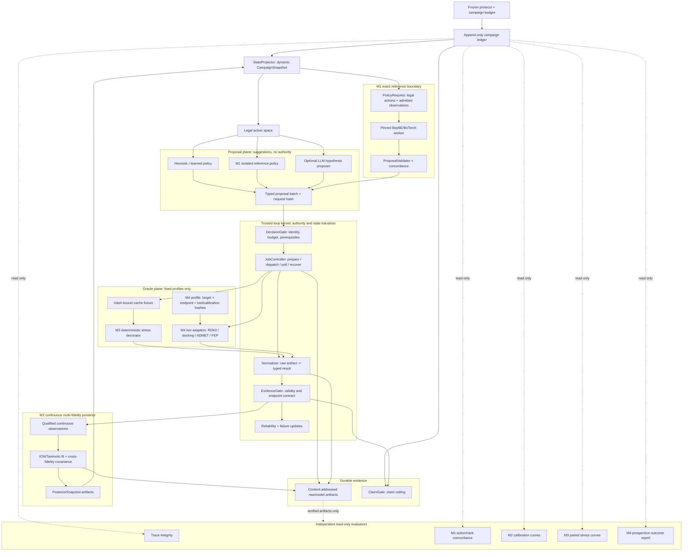

# Four-Module Engineering Design

## 1. Decision

The project remains one event-driven acquisition loop. The four additions are
not four agents and not four independent pipelines:

1. an exact reference-policy boundary;
2. a continuous multi-fidelity posterior service;
3. a deterministic credibility stress environment; and
4. an asynchronous prospective oracle boundary.

The existing `loop_harness.v2` package remains the trusted kernel. Schema
versions may advance, but the runtime must not be copied into a second `v3`
implementation. Synchronous cache experiments remain supported while live
oracles use a resumable job lifecycle.

### Current implementation status

The first implementation tranche is now present:

- M1: `PolicyRequest`, `PolicyProposalBatch`, canonical subprocess adapter,
  legal-action validator, protocol registration, concordance evaluator, and
  `scripts/run_jensen_baybe_reference_worker.py`.
- M2: content-addressed artifact store, continuous ICM/Tanimoto posterior
  fitter, posterior repository, calibration evaluator, retrospective calibration
  curve runner/CLI, posterior ledger events, and an optional runtime path
  consumed by TVR.
- M3: deterministic failure/noise/scaffold-bias/drift executor decorator,
  public scenario registration, contamination evaluator, and paired stress
  benchmark runner.
- M4: prepare/dispatch/poll/normalize job contracts, resumable job controller,
  shared post-result settlement, cache-backed live adapter, and fixed JSON
  command adapter with shell-disabled execution. JSON command profiles now bind
  target/endpoint identity and optional profile/calibration artifact hashes.

The current held-out calibration run is retained at
`state/jensen-calibration-offset0.json`: five targets, 64-candidate windows,
three warm-start seeds, two continuation snapshots, 45 rows, and three curve
points. It is a retrospective diagnostic artifact only.

The expanded calibration run is retained at
`state/jensen-calibration-all-windows.json`: five targets, offsets 0/64/128,
three seeds, 135 snapshot rows, and 45 cohort observations per
observation-count point.

The first Factor-D reference concordance report is retained at
`state/jensen-reference-concordance-factor-d.json`. The isolated worker is
deterministic and passes the input leakage probe, but its three semantic actions
do not match either the corrected local NumPy TVR policy or the explicit
legacy-index diagnostic mode; the report therefore records
`code_reproduction_status=PASS` and `result_replication_status=FAIL`.

`state/jensen-reference-variant-audit.json` narrows the archived environment to
BayBE 0.9.x: 0.9.0 and 0.9.1 produce the same tested trace, while 0.10.0 is API
incompatible. BayBE 0.9.1 is the strongest dated candidate, but the archive
does not contain enough provenance to select uniquely between 0.9.0 and 0.9.1.
The audit also confirms a subset-index/full-covariance-index defect in the
archived recommender. This explains one discrepancy source but does not restore
trace concordance.

The first computational prospective M4 campaign is retained under
`state/prospective-rdkit-qed-v3/`. It executed six real RDKit QED actions,
recovered six jobs through recreated controllers, rejected six duplicate
dispatch attempts, passed a timeout probe, and ended at the declared budget
with `prospective_status=PASS`. Its claim ceiling is operational
computational-loop integrity only.

The first fixed-profile real-oracle campaign is retained under
`state/aldh1-real-oracle-loop-v1/`. Four ALDH1 candidates were screened by the
hash-bound ADMET-AI 2.0.1 model profile; two were promoted under a declared
budget to the hash-bound AutoDock Vina 1.2.7/4WP7 profile. The campaign spent
exactly 5.0 units, replayed with `trace_status=PASS`, and created no synthetic
cross-endpoint score. Its status is `COMPUTATIONAL_PROXY_ONLY`: the ADMET model
is not calibrated for this candidate distribution, and one pose-recovery case
does not validate docking affinity ranking or molecular activity.

`scripts/audit_four_module_artifacts.py` writes
`state/four-module-artifact-audit.json`. The current audit verifies the M1/M2/
M3/M4 report shapes, 405 calibration artifacts, 32 prospective artifacts,
ledger replay, and the explicit claim ceilings.

`scripts/build_four_module_final_report.py` writes
`state/four-module-final-report.json`, which keeps operational, M1 reference,
retrospective calibration, stress robustness, and computational prospective
evidence in separate sections.

The candidate Python 3.12 reference environment runs BayBE 0.9.0 and 0.9.1
variants behind the worker boundary. The remaining exact-lock gap is now an
explicit archive limitation, not an untracked engineering task. Docking and
ADMET execution profiles are integrated. A WSL/OpenFE 1.12.0 environment now
passes OpenMM CPU/CUDA checks and the standard OpenFE suite, as recorded in
`state/openfe-wsl-environment-v1.json`; target-specific FEP calibration,
external assays, and any scientifically admitted FEP profile remain future
validation work.

## 2. Non-Negotiable Invariants

- The policy proposes; the harness validates, authorizes, executes, and records.
- A policy sees only campaign state, legal actions, and admitted observations.
- Hidden truth, stress realizations, and post-run evaluation data are never
  attached to `CampaignSnapshot`.
- Measurement validity, scientific outcome, execution failure, and claim
  permission remain separate state dimensions.
- Model binaries and raw oracle files are external artifacts; the ledger stores
  immutable references and content hashes.
- Every admitted action reaches one terminal result: success, failure, timeout,
  denial, cancellation, or recovery-required.
- LLM output may propose hypotheses or typed actions but cannot update beliefs,
  normalize evidence, authorize tools, spend budget, or upgrade claims.
- Retrospective, stress, computational prospective, and experimental prospective
  results have different claim ceilings.

## 3. Updated Architecture



## 4. Shared Contract Extensions

### 4.0 Frozen experiment protocol

Every comparative, stress, or prospective campaign references a frozen
`ExperimentProtocolSpec` artifact containing target/cohort identity, policy
arms, randomization, budgets, stopping rules, primary and secondary metrics,
exclusions, evaluator version, and claim ceiling. Register it before the first
policy request with `EXPERIMENT_PROTOCOL_REGISTERED`. A changed protocol creates
a new campaign; it never mutates the active one.

### 4.1 Artifact reference

```python
@dataclass(frozen=True)
class ArtifactRef:
    artifact_id: str
    relative_path: str
    sha256: str
    media_type: str
    byte_size: int
    producer_version: str
```

Absolute paths and mutable files are never scientific identity. Consumers must
verify `sha256` before use.

### 4.2 Policy request and proposal

```python
@dataclass(frozen=True)
class PolicyRequest:
    campaign_id: str
    state_sha256: str
    legal_action_ids: tuple[str, ...]
    budget_available: float
    posterior_snapshot_id: str | None
    deterministic_seed: int

@dataclass(frozen=True)
class PolicyProposalBatch:
    policy_id: str
    policy_version: str
    request_sha256: str
    proposed_action_ids: tuple[str, ...]
    score_artifact: ArtifactRef | None
```

The kernel rejects stale requests, unknown actions, duplicate actions, and
actions not present in the current legal action space.

### 4.3 Continuous posterior snapshot

The existing binary `BeliefState` remains for binary endpoints. Continuous
values use a separate contract instead of weakening the `[0, 1]` invariant.

```python
@dataclass(frozen=True)
class PosteriorSnapshot:
    snapshot_id: str
    endpoint_id: str
    model_spec_id: str
    training_observation_ids: tuple[str, ...]
    training_set_sha256: str
    candidate_set_sha256: str
    model_artifact: ArtifactRef
    prediction_artifact: ArtifactRef
    diagnostics_artifact: ArtifactRef
    fit_status: str
```

`prediction_artifact` contains candidate-level mean, variance, and optional
cross-fidelity covariance. Policies read it through a hash-verifying
`PosteriorRepository`, not by opening arbitrary paths.

### 4.4 Oracle job lifecycle

```python
@dataclass(frozen=True)
class OracleJobSpec:
    job_id: str
    action_id: str
    adapter_id: str
    adapter_version: str
    input_manifest: ArtifactRef
    reserved_cost: float
    timeout_seconds: float
    approval_id: str | None

@dataclass(frozen=True)
class OracleJobReceipt:
    job_id: str
    status: str
    actual_cost: float
    raw_artifacts: tuple[ArtifactRef, ...]
    started_at: str | None
    completed_at: str | None
    failure_code: str | None
```

## 5. Event Model Extension

Add only events required for deterministic recovery:

| Event | Purpose |
| --- | --- |
| `POLICY_PROPOSAL_RECORDED` | Bind policy version and request hash to proposed actions |
| `EXPERIMENT_PROTOCOL_REGISTERED` | Freeze design, outcomes, exclusions, and claim ceiling before execution |
| `BUDGET_RESERVED` | Prevent concurrent jobs from overspending the campaign |
| `ORACLE_JOB_PREPARED` | Bind exact inputs, adapter, timeout, and approval |
| `ORACLE_JOB_DISPATCHED` | Record that an external attempt actually started |
| `ORACLE_JOB_TERMINATED` | Record success, failure, timeout, denial, or cancellation |
| `RAW_ARTIFACT_RECORDED` | Bind output files before normalization |
| `POSTERIOR_FIT_RECORDED` | Bind qualified training evidence to one model snapshot |
| `STRESS_SCENARIO_REGISTERED` | Bind a public scenario manifest without revealing latent realization |

`ORACLE_RESULT_RECORDED`, `EVIDENCE_ASSESSED`, reliability updates, belief or
posterior updates, and `ROUND_COMPLETED` remain the scientific result chain.

## 5.1 Optional Agent Surface

The closed loop does not require an LLM. When one is enabled, it receives a
compact, deterministic context assembled from verified state:

- scientific goal and frozen protocol summary;
- budget, round, pending-job, and stop state;
- candidate-level endpoint posterior summaries;
- oracle reliability, failures, and unresolved evidence conflicts;
- legal action IDs and current claim ceiling.

Its initial typed tools are deliberately narrow:

| Tool | Authority |
| --- | --- |
| `read_campaign_summary` | read-only |
| `read_candidate_evidence` | read-only, verified observations only |
| `propose_scientific_question` | draft one typed question |
| `propose_candidate` | draft candidate plus provenance; no campaign admission |
| `submit_action_proposal` | submit legal action IDs to `DecisionGate` |
| `request_protocol_revision` | pause and ask for human review |

The LLM has no `execute_oracle`, `write_evidence`, `update_posterior`, or
`allow_claim` tool. Long-session context is rehydrated from the ledger,
protocol, active posterior snapshot, and pending job receipts rather than from
free-form chat memory.

## 6. M1 - Exact Jensen Reference Reproduction

### Objective

Establish whether the published implementation can be executed and whether its
policy decisions and reported metrics can be reproduced. Do not treat a local
structural approximation as the original algorithm.

### Components

| Component | Responsibility |
| --- | --- |
| `reference_policy.py` | Convert legal loop state into a policy-neutral request and validate returned action IDs |
| `scripts/run_jensen_baybe_reference_worker.py` | Run the original BayBE/BoTorch code in an isolated pinned environment |
| `reference_reproduction.py` | Run declared seeds/targets and compare original and local traces |
| `ReferenceConcordanceEvaluator` | Read-only action, ranking, cost, and outcome concordance |

The original dependencies must not be installed into the harness environment.
The adapter invokes a pinned subprocess or container and exchanges canonical
JSON plus content-addressed artifacts.

### Input boundary

The reference process receives only:

- candidate ID and SMILES;
- acquired observations;
- currently legal candidate-oracle actions;
- fidelity costs and remaining budget;
- declared random seed and algorithm parameters.

It does not receive unseen dose-response values or evaluator files.

### Reproduction layers

1. **Environment reproduction:** imports, model fit, and one recommendation run.
2. **Decision reproduction:** deterministic action sequence for frozen fixtures.
3. **Metric reproduction:** target-level recovery/regret under the published
   initialization, batching, and budget semantics.

The worker is invoked through `SubprocessReferencePolicy` and communicates only
the `reference_policy_input.v1` / `reference_policy_output.v1` JSON boundary.
In the base harness environment it is expected to fail with an explicit
dependency-unavailable error until the separately pinned reference environment
is installed.

### Outputs

- dependency lock and runtime manifest;
- per-step policy request/response artifacts;
- action concordance and ranking concordance report;
- explicit `code_reproduction_status` and `result_replication_status`;
- discrepancy ledger with attributable causes.

### Exit gate

- Two identical runs produce identical recommendation traces or document the
  irreducible nondeterministic source.
- The reference process passes a leakage probe that plants a sentinel in hidden
  truth and confirms it never appears in policy inputs.
- Published and local cost/batch semantics are reconciled.
- Any unresolved numerical mismatch prevents `result_replication_status=PASS`.

The current Factor-D probe is intentionally below this exit gate: it validates
the boundary and environment execution and narrows BayBE to 0.9.x, while the
semantic action mismatch and unrecoverable exact historical lock remain
explicit reproduction discrepancies.

## 7. M2 - Continuous Multi-Fidelity Belief Engine

### Objective

Maintain a calibrated posterior over the high-fidelity endpoint after every
qualified continuous observation, and expose that posterior to acquisition
policies without making model output authoritative evidence.

### First implementation

- Morgan radius-2 fingerprints with a versioned fingerprint manifest.
- ICM Tanimoto GP matching the reference task covariance structure.
- Explicit endpoint direction and unit normalization.
- Per-oracle noise and task covariance.
- High-fidelity posterior mean and variance for every candidate.
- Cross-fidelity covariance required by TVR.

The first implementation should reuse the exact reference model where feasible.
A second model family is added only after regression and calibration evals show
a concrete need.

### Fit flow

```text
qualified continuous observations
  -> deterministic training table
  -> training table SHA256
  -> model fit in isolated model runner
  -> model + prediction + diagnostics artifacts
  -> PosteriorSnapshot event
  -> state projection exposes snapshot ID
  -> policy reads verified posterior batch
```

Failures, timeouts, rejected evidence, and abstentions update reliability/failure
state but never enter the scientific target vector as zero.

### Diagnostics

- negative log predictive density;
- CRPS or an equivalent proper scoring rule;
- empirical 50%, 80%, and 95% interval coverage;
- high-fidelity rank correlation;
- simple regret and top-fraction recovery;
- task covariance stability;
- fit failures and numerical jitter used.

`JensenCalibrationRunner` executes the fixed cohort protocol and records one
row per posterior snapshot: warm-start state, then each completed continuation
round. The curve is grouped by qualified observation count and averages only
descriptive diagnostics across declared cohorts. The evaluator reads the
high-fidelity truth through `load_jensen_high_fidelity_truth`; that truth is not
attached to runtime state, policy requests, or posterior training artifacts.
Candidates whose high-fidelity result is already in the snapshot training set
are excluded from predictive calibration, preventing in-sample fit from being
reported as held-out performance.
`scripts/run_jensen_calibration.py` is the reproducible entry point.

### Baselines and ablations

- constant-mean prior;
- independent single-fidelity GP;
- ICM GP without reliability weighting;
- full ICM GP with reliability-aware acquisition.

### Exit gate

- A qualified observation changes posterior state for at least one unobserved
  candidate in deterministic synthetic tests.
- Posterior variance contracts locally after informative observations.
- Invalid evidence causes exactly zero change to training-set hash.
- Model and predictions round-trip through artifact verification.
- Across the predeclared Jensen cohorts, the model is not dominated by both the
  constant and single-fidelity baselines on calibration and regret.

## 8. M3 - Credibility Stress Laboratory

### Objective

Measure whether the loop detects and adapts to unreliable oracles instead of
remaining confidently wrong.

### Architecture

`StressOracleExecutor` decorates a cache fixture. It applies a frozen scenario
after exact action admission and before the result reaches `EvidenceGate`.
The unperturbed record remains evaluator-only.

```python
@dataclass(frozen=True)
class StressScenarioSpec:
    scenario_id: str
    scenario_version: str
    public_manifest_sha256: str
    realization_seed: int
    injectors: tuple[str, ...]
    severity: float
```

The ledger stores only the public manifest hash. Hidden scaffold assignments,
noise draws, and counterfactual clean outcomes remain in the environment.

### Injectors

| Injector | State dimension changed |
| --- | --- |
| `ExecutionFailureInjector` | status, failure code |
| `MeasurementValidityInjector` | provenance completeness, QC validity |
| `HeteroscedasticNoiseInjector` | continuous outcome uncertainty |
| `ScaffoldBiasInjector` | systematic outcome bias by scaffold |
| `FidelityReversalInjector` | low/high-fidelity association |
| `TemporalDriftInjector` | oracle bias/reliability over round index |
| `CostLatencyInjector` | actual cost, timeout, completion delay |
| `ProxyGamingInjector` | candidate distribution optimized for a weak proxy |

For paired policy arms, stochastic draws use common random numbers keyed by
`scenario_id + target_id + candidate_id + oracle_id + attempt_ordinal`, not by
policy-specific action IDs.

### Experiment design

1. One-factor severity curves establish failure thresholds.
2. Only three predeclared interactions are run initially:
   `scaffold_bias x proxy_gaming`, `failure x cost`, and
   `drift x reliability`.
3. Every condition uses common candidate cohorts, warm starts, budget ceilings,
   and stress realizations.

### Primary metrics

- contamination count: invalid measurements entering posterior training;
- high-fidelity simple regret;
- top-fraction recovery;
- high-fidelity waste;
- cost to first top candidate;
- oracle-reliability calibration;
- drift detection delay;
- recovery cost after an oracle becomes unreliable.

### Exit gate

- Contamination count remains zero under every validity injector.
- Trace evaluation passes for success and every injected failure mode.
- Reliability-aware and unaware ablations produce complete degradation curves,
  including negative findings.
- Scenario seeds, severities, exclusions, and primary metrics are frozen before
  aggregate results are read.
- Stress results authorize only a simulated-robustness claim.

The retained all-cohort stress run is
`state/jensen-stress-all-cohorts.json`: 270 paired arms across five targets,
three offsets, three seeds, and three failure-rate severities. Every arm has
`trace_status=PASS`, `stress_status=PASS`, and zero reported contamination;
the output remains descriptive and does not authorize a policy-superiority
claim.

## 9. M4 - Prospective Real-Oracle Runtime

### Objective

Run a policy-bounded computational discovery loop against real tools, tolerate
long-running failures, and ingest external assays without allowing tool output
to bypass evidence and claim gates.

### Runtime split

Refactor the current synchronous `LoopRuntime.step()` into five composable
commands while preserving `step()` as a cache-fixture convenience wrapper:

1. `propose()` - enumerate and rank legal actions;
2. `admit()` - validate identity, reserve budget, and resolve approval;
3. `dispatch()` - prepare and start an oracle job;
4. `ingest()` - verify raw artifacts and normalize one terminal result;
5. `settle()` - assess evidence, update reliability/posterior, and close round.

The first live release permits one pending action at a time. Concurrent batches
are deferred until single-job recovery is proven.

### Adapter protocol

```python
class LiveOracleAdapter(Protocol):
    def prepare(self, action, state) -> OracleJobSpec: ...
    def preflight(self, job, state) -> PreflightDecision: ...
    def dispatch(self, job) -> DispatchReceipt: ...
    def poll(self, job_id) -> OracleJobReceipt: ...
    def normalize(self, receipt) -> OracleResult: ...
```

Every method returns a typed result, including denial and failure. Adapters do
not append ledger events directly.

### Profile and calibration binding

`JsonCommandProfile` is the narrow local adapter for a fixed executable. A
profile may declare `target_id`, `endpoint_id`, `profile_artifact`, and
`calibration_artifact`; a production computational profile sets
`require_calibration=True`. During both `prepare()` and `preflight()` the
adapter verifies content-addressed artifact bytes, checks target/endpoint
identity, and writes the binding hashes into the input manifest. Normalized
results carry the same hashes in provenance. This proves which profile and
calibration inputs were used; it does not by itself grant evidence
qualification, which remains the responsibility of `EvidenceGate` and the
oracle `anchor_id`.

### Initial registry

| Adapter | Execution mode | Default authority |
| --- | --- | --- |
| RDKit chemistry checks | local synchronous | autonomous within fixed profile |
| Docking | local/cluster asynchronous | autonomous only for hash-bound receptor, pocket, engine profile, and compute budget |
| ADMET-AI | local asynchronous | autonomous only for pinned model and reviewed endpoint policy |
| Rescoring/FEP | asynchronous expensive | exact action approval |
| External assay importer | external result ingestion | human approval and independent receipt verification |
| Synthesis order | external irreversible | out of autonomous scope |

Existing v1 prospective approval, calibration, execution receipt, admission
bundle, and commit-audit code should be wrapped behind these adapters. It should
not remain a parallel campaign state machine.

### Recovery

- An admitted action reserves budget before dispatch.
- Dispatch uncertainty produces `recovery_required`, never an automatic retry.
- Idempotency key is `campaign_id + action_id + attempt_ordinal`.
- A verified terminal failure consumes actual incurred cost and releases the
  unused reservation.
- Restart reconstructs pending jobs from ledger events and polls by job ID.
- Normalization is pure and replayable from raw artifact hashes.

### Prospective rollout

1. **Shadow:** execute real tools but keep policy decisions cache-backed.
2. **Computational prospective:** policy chooses RDKit, docking, and ADMET under
   a frozen protocol and budget.
3. **External assay pilot:** freeze recommendations before assay outcomes are
   imported.

### Exit gate

- One full shadow campaign survives timeout, restart, and duplicate-dispatch
  probes without double spending or duplicate evidence.
- The computational prospective protocol is frozen before any high-fidelity
  result is observed.
- Evaluator access is separate from runtime access.
- Every raw output is bound to tool version, input hashes, and normalization
  policy.
- Successful completion permits an operational prospective-loop claim, not a
  molecule-efficacy claim.

The RDKit QED v3 campaign satisfies this gate for one descriptor profile. The
ALDH1 real-oracle campaign additionally satisfies the operational parts for
hash-bound ADMET-AI and Vina profiles, including autonomous interleaving and
budget accounting. It does not establish predictive calibration, docking
ranking validity, experimental activity, safety, or assay validation.

## 10. Permission Matrix

| Operation | Harness policy |
| --- | --- |
| Read ledger and verified artifacts | allow |
| Fit model from qualified observations | allow in isolated runner |
| Run cache/reference/stress environment | allow within declared experiment budget |
| Run pinned RDKit profile | allow |
| Run pinned docking/ADMET profile | allow within campaign compute authorization |
| Change receptor, endpoint policy, model, or calibration anchor | require protocol revision and approval |
| Run expensive rescoring/FEP | exact action approval |
| Import external assay | exact receipt verification and human approval |
| Order synthesis or wet-lab work | deny autonomous execution |
| Upgrade scientific claim | `ClaimGate`; human review where protocol requires |

## 11. Evaluation and Claim Ladder

| Level | Required evidence | Maximum claim |
| --- | --- | --- |
| E0 | unit and trace tests | implementation behaves as specified |
| E1 | exact reference reproduction | original baseline was reproduced under declared environment |
| E2 | multi-target retrospective benchmark | policy has retrospective support on these cohorts |
| E3 | frozen stress protocol | policy is robust to these simulated failures |
| E4 | computational prospective run | loop operated prospectively with real computational tools |
| E5 | blinded external assay replication | candidates showed the declared assay outcome under that protocol |

No level supports clinical efficacy or safety claims.

## 12. Minimal File Plan

Keep the existing flat v2 style and add only these modules initially:

```text
src/loop_harness/v2/
  reference_policy.py
  reference_reproduction.py
  model_store.py
  continuous_belief.py
  calibration.py
  stress.py
  stress_evaluation.py
  job_runtime.py
  live_adapters.py
```

Do not create a multi-service platform or multi-agent scheduler. Split a module
only after it exceeds one coherent responsibility.

## 13. Implementation Sequence

### Release 2.2a - Reference boundary

- Add policy request/proposal contracts.
- Build isolated original-policy runner and leakage probe.
- Produce Factor-D golden trace before broad target runs.

### Release 2.2b - Continuous posterior

- Add artifact/model repository and posterior snapshot event.
- Implement exact-reference ICM Tanimoto GP first.
- Update TVR policy to consume `PosteriorRepository` rather than fit internally.
- Run calibration and ablation suite on all frozen Jensen cohorts.

### Release 2.3 - Stress laboratory

- Add deterministic stress decorator and single-factor injectors.
- Freeze scenario protocol before running aggregate comparisons.
- Add the three declared interaction experiments only after unit invariants pass.

### Release 3.0 - Prospective execution

- Split runtime into propose/admit/dispatch/ingest/settle.
- Bridge existing ADMET and docking control artifacts into v2 adapters.
- Pass shadow-mode recovery tests.
- Freeze and run the first computational prospective campaign.

## 14. Test Matrix

| Layer | Required tests |
| --- | --- |
| Contracts | schema validation, JSON round-trip, backward projection |
| Reference | dependency manifest, deterministic request, leakage sentinel, golden action trace |
| Posterior | invalid-evidence exclusion, variance contraction, artifact hash failure, fit recovery |
| Stress | common-random-number pairing, each injector, clean-truth isolation, scenario replay |
| Jobs | timeout, denial, crash-before-receipt, duplicate dispatch, restart, budget reconciliation |
| Live adapters | preflight mismatch, tool version mismatch, malformed output, normalization replay |
| Evaluation | evaluator read-only hash check, missing arm, outcome leakage, claim ceiling |

## 15. Program Completion Criteria

The four-module program is complete only when:

1. M1 has an explicit reproduction verdict, including failures.
2. M2 supplies calibrated continuous posterior snapshots to policies.
3. M3 produces frozen, paired robustness curves with zero evidence contamination.
4. M4 completes a restart-safe computational prospective campaign.
5. All experiment artifacts can be regenerated from protocol, ledger, dependency
   manifests, and content-addressed raw artifacts.
6. The final report states separately what was operationally demonstrated,
   retrospectively supported, stress-tested, and prospectively observed.
