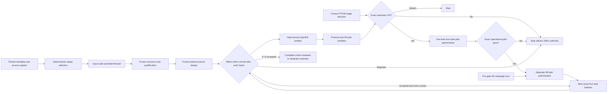

# JNK1 Untouched-Target Confirmation

## Scientific Role

This stage is a conditional external-target replication of the PTP1B
lambda-density repair signal. It is not a second development fit and it is not
an accuracy benchmark. JNK1 simulation may be authorized only if the frozen
PTP1B release decision is exactly
`ADVANCE_TO_UNTOUCHED_TARGET_CONFIRMATION`.

A JNK1 GO would support one target-level external replication signal. It would
not establish general repair superiority, experimental accuracy improvement,
molecular efficacy, or autonomous deployment readiness.

## Result-Blind Target Selection

The target was selected before its structures were checked out. Eligibility
used only the pinned JACS metadata, known-access register, input-blob presence,
20-50 nodes, and dynamic range of at least 2.5 kcal/mol. Known outcome-exposed
TYK2, P38, PTP1B, and CDK2 were ineligible. JNK1 and BACE1 were eligible.

The frozen key is:

```text
sha256("ptp1b-untouched-confirmation-v1" + "|" + canonical_target_id)
```

JNK1 had the lexicographically smaller key and was registered as the target;
BACE1 is only the recorded fallback. Automatic substitution is prohibited.

## Recorded Exposure And Firewall

The source JNK1 edge file combines connectivity with experimental ddG. After
target registration, its header and first four data rows were displayed during
input inspection. This does not alter the already-completed target selection,
and no JNK1 public FEP outcome or official overlap value was accessed. It does
mean that complete protocol-development label blinding cannot be claimed.

The exposure is preserved in
`state/jnk1-post-selection-edge-label-exposure-v1.json`. All subsequent edge
qualification is bound to a derived two-column connectivity file containing
only `ligand_1` and `ligand_2`. Experimental accuracy is not a primary endpoint,
and the limitation must remain in final interpretation.

## Structure-Only Qualification

The accepted input audit found 60 source edges, 38 valid ligand records, no
missing connectivity endpoints, and 5,993 protein atom records. Before mapping
features were computed, the qualification rule and implementation were frozen.

Eligible edges must be:

- non-identical by canonical isomeric SMILES;
- formal-charge conserving;
- uniquely mapped by Kartograf with the frozen ring filters;
- at least 0.5 in symmetric mapped-heavy-atom fraction.

Edges are ranked by descending unmapped-heavy-atom fraction, then descending
maximum side-specific unmapped atoms, then a frozen SHA-256 tiebreaker. A
deterministic greedy pass selects three vertex-disjoint edges. The qualification
accepted 43 eligible edges and selected:

- `18638-1->18660-1`
- `18659-1 flip->18631-1 flip`
- `18652-1 flip->18658-1 flip`

These are input-derived choices, not scientific outcomes.

## Frozen Paired Design

The design uses the same narrow intervention as PTP1B:

- control: 11 lambda windows;
- repair: 21 nested lambda windows;
- identical charged components, atom mappings, force field, sampler, and run
  length between arms;
- 1 ns equilibration plus 5 ns production;
- complex and solvent legs;
- three campaign repeats;
- 36 full tasks in 18 paired `edge x leg x repeat` units.

The primary gate is also unchanged: overlap threshold 0.03, at least two
passing repeats per leg, at least two repaired edges, overlap-failure reduction
of at least 0.50, median edge-ddG repeat-SD increase no greater than 0.25
kcal/mol, compute-cost ratio no greater than 2.20, and all tasks successful.

Twenty-picosecond profiles are smoke tests only and cannot enter scientific
evaluation.

## State And Authority



The state projector hashes preparation artifacts but does not read scientific
outcomes. Selection, audit, qualification, profile construction, protocol
registration, and task-manifest construction grant no simulation authority.
Even after all preparation completes, the only legal state before PTP1B GO is
`WAITING_FOR_UPSTREAM_DECISION`.

The result-blind preparation is now complete. AM1-BCC repeatability produced a
strict-majority modal vector for all six selected ligands; 24 full/smoke
transformation files, the paired protocol, and the 36-task manifest are
present. The current state is `WAITING_FOR_UPSTREAM_DECISION`, not an active
JNK1 campaign.

A separately frozen four-task operational pilot bridges the upstream decision
to JNK1 execution. Its plan has no authority. A watcher may only wait until the
complete PTP1B decision exists. Exact GO creates a one-time serial
authorization for one frozen edge across control/repair and solvent/complex;
exact NO-GO records non-activation. Every task requires the prior task's
successful start/receipt chain. Pilot metrics are checked only for finite
values and matrix shape, are never compared across arms, and cannot enter the
36-task evaluator. A successful pilot still grants no full-execution authority.

The downstream full-campaign controller is also frozen before the upstream
decision and before the pilot verdict. Its lock grants wait authority only.
The full authorization can be materialized only when the upstream decision is
the exact development-only GO and the locked pilot evidence recomputes to four
successful terminal receipts. The authorization covers all and only the frozen
36 tasks in a balanced serial order. It forbids retry, resume, overwrite,
reordering, parallel execution, profile retuning, interim comparison, and
outcome-dependent stopping.

Each `edge x repeat` block contains both thermodynamic legs and both arms. A
metric-blind auditor must accept the exact start/receipt/outcome hash prefix
after every four-task block before the existing authorization may continue.
The auditor reads status, cost, timestamps, and hashes, but does not parse an
outcome or experimental label. Only nine accepted commits and 36 successful
receipts release the complete cohort to a separately locked paired evaluator;
completion itself grants no recovery, publication, or scientific-claim
authority.

## Complete-Cohort Evaluation

The evaluator is frozen before the JNK1 pilot and before every JNK1 full
outcome. It cannot inspect an outcome until the full completion artifact has
been independently rebuilt from 36 successful receipts and nine current
accepted batch commits. The primary endpoint is exactly the protocol's
predeclared multicriterion gate: repaired-edge count, overlap-failure-rate
reduction, non-degradation of repeat dDG stability, and compute-cost ratio.
There is no post-outcome threshold selection, complete-case deletion, pilot
substitution, LLM interpretation, or formal significance test in the primary
gate.

The companion report is descriptive and cannot change the primary decision.
It reports paired rescue/harm counts, edge-level diagnostics, leave-one-edge-out
direction, and overlap-threshold sensitivity at 0.02, 0.03, 0.04, and 0.05.
Three selected edges are the scientific units; 18 edge-by-leg-by-repeat pairs
are correlated technical units. Exact paired sign values are descriptive only,
and no cluster confidence interval or superiority inference is permitted from
three edges.

The evaluator opens no JNK1 experimental-label source. The recorded four-row
post-selection exposure remains a mandatory limitation, so experimental
accuracy is not evaluated. Primary GO maps only to
`SUPPORT_ONE_TARGET_LEVEL_EXTERNAL_REPLICATION_WITH_LIMITATIONS`. It may be
described as one target-level external replication signal and descriptive
PTP1B/JNK1 concordance. It is not strict independent confirmation, general
repair superiority, molecular efficacy, autonomous deployment, or evidence for
untested targets.

## Principal Artifacts

- `state/ptp1b-untouched-contamination-register-v1.json`
- `state/ptp1b-untouched-target-selection-v1.json`
- `state/ptp1b-untouched-confirmation-contract-v1.json`
- `state/jnk1-post-selection-edge-label-exposure-v1.json`
- `state/jnk1-untouched-input-audit-v1.json`
- `state/jnk1-untouched-qualification-lock-v1.json`
- `state/jnk1-untouched-target-qualification-v1.json`
- `state/jnk1-protocol-design-lock-v1.json`
- `state/jnk1-charge-repeatability-audit-v1.json`
- `external/profiles/jnk1-paired-repair-v1/profile-manifest.json`
- `state/jnk1-paired-repair-protocol-v1.json`
- `state/jnk1-paired-repair-task-manifest-v1.json`
- `state/jnk1-operational-pilot-plan-v1.json`
- `state/jnk1-conditional-pilot-lock-v1.json`
- `state/jnk1-conditional-pilot-runtime-v1.json`
- `state/jnk1-full-campaign-lock-v1-supersession.json`
- `state/jnk1-full-campaign-lock-v2.json`
- `state/jnk1-full-campaign-snapshot-v2.zip`
- `state/jnk1-full-campaign-watcher-registration-v2.json`
- `state/jnk1-full-campaign-runtime-v2.json`
- conditional: `state/jnk1-full-execution-authorization-v2.json`
- conditional: `state/jnk1-full-batch-{0..8}-commit-v1.json`
- conditional: `state/jnk1-full-execution-complete-v1.json`
- `state/jnk1-evaluator-lock-v1.json`
- `state/jnk1-evaluator-snapshot-v1.zip`
- `state/jnk1-evaluator-watcher-registration-v1.json`
- `state/jnk1-evaluator-runtime-v1.json`
- conditional: `state/jnk1-primary-repair-evaluation-v1.json`
- conditional: `state/jnk1-repair-credibility-report-v1.json`
- conditional: `state/jnk1-untouched-confirmation-decision-v1.json`
- `state/jnk1-untouched-stage-state-v1.json`
