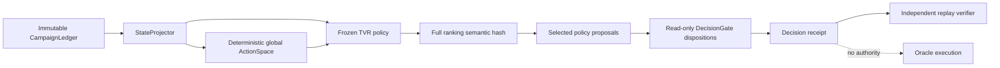

# Prospective V2 Policy Bridge

## Purpose

The bridge makes the frozen v2 TVR policies replayable in a future prospective
study without weakening the existing v1 prospective control plane.

The old receipt contract consumes a v1 `CampaignStore` and per-subject policy
decisions. TVR instead consumes a complete v2 `CampaignLedger`, reconstructs a
multi-fidelity campaign state, and ranks a shared candidate-oracle action space.
Those state contracts are not interchangeable.

## Runtime Contract



`src/loop_harness/v2/prospective_policy_bridge.py` implements two strict policy
kinds:

- `jensen_tvr`
- `reliability_tvr`

The policy spec binds the v2 state contract, policy parameters, selection count,
Python/NumPy/RDKit versions, and source hashes for the ledger, projector, action
space, TVR, and reliability-aware policy. Unknown policy parameters fail closed.

The decision receipt binds:

- the complete ledger SHA-256;
- the deterministic legal action-space semantic hash;
- the complete policy-ranking semantic hash;
- the selected proposal semantics;
- the read-only kernel disposition for each selected proposal;
- the exact runtime manifest and policy spec.

It never admits, dispatches, or executes an action. A separate execution control
plane must consume a verified proposal and any required authorization.

## Experimental Unit Correction

The current v5 prospective protocol uses randomized candidate-promotion
episodes as its denominator. That is not directly valid for TVR: actions share
one posterior, one budget, and one evolving observation history, so individual
candidate decisions are coupled.

The proposed study unit is an independent target/cohort campaign replicate:

1. Freeze the same starting candidate pool, features, oracle contracts, and
   budget for both arms.
2. Run the two policy arms with isolated observation histories.
3. Keep assay execution and outcome capture blinded to arm-level analysis.
4. Assay the union of promoted candidates; model overlaps as paired correlated
   observations rather than duplicate independent hits.
5. Compare policies within campaign replicate, then aggregate campaign-level
   contrasts across independent target/cohort replicates.

This tests the autonomous loop as a sequential decision system rather than
treating hundreds of dependent molecule choices as fake sample size.

## Current Readiness

The generated handoff is:

- `state/prospective-v2-design-handoff-v1.json`
- SHA-256: `682f3bc77befa042507cd7ab44823543b53b9e15092cc6db26c976a2c7530150`
- Verification: `state/prospective-v2-design-handoff-verification-v1.json`
- Verification SHA-256: `6477d811bdc835000f2401eceec805d48fd40ef8db678d4cc187ac14af056691`
- Status: `READY_FOR_ASSAY_SPECIFIC_DESIGN_INPUTS`

The runtime and replay receipt are ready. Prospective assay protocol registration
is intentionally blocked on eight external inputs: target/cohort replicates,
candidate-pool freeze, oracle contracts, assay endpoint and site, campaign
budget, effect-size and power assumptions, external assignment/blinding, and
scientific/execution acceptance. The harness must not invent these inputs.

## Commands

Build and verify the design handoff:

```powershell
$env:PYTHONPATH='src'
python scripts/build_prospective_v2_design_handoff.py
```

Record and replay a policy decision against an existing v2 ledger:

```powershell
python scripts/record_prospective_v2_policy_decision.py campaign-ledger.json round-001 --role credibility_aware --output decision-receipt.json
python scripts/verify_prospective_v2_policy_decision.py campaign-ledger.json decision-receipt.json --role credibility_aware --output decision-fidelity.json
```
