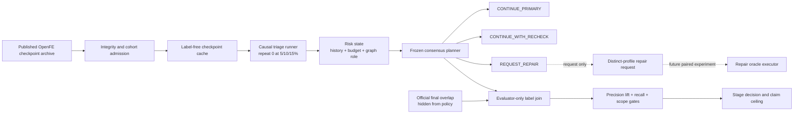

# PTP1B FEP Risk-to-Action Stage

## Decision

This stage is complete. The machine-readable decision is:

`NO_GO_AUTONOMOUS_TRIAGE_DEPLOYMENT_CONTINUE_TO_PAIRED_REPAIR_ORACLE_DESIGN`

The frozen early-risk rule enriched strongly for final overlap failures, but it
did not meet the preregistered coverage gate. It is therefore useful as a
research signal, not ready as an autonomous stop or repair policy.

## Component Architecture

The planner has no execution authority. `REQUEST_REPAIR` does not replay an
unstarted repeat from the same cache and does not synthesize a repaired result.
A real repair requires a distinct oracle-profile hash, separate provenance,
new cost, and a paired outcome.

## Frozen Rule

The rule was developed on P38 and locked before PTP1B checkpoint values were
accessed:

- observe repeat 0 for both complex and solvent legs at 5%, 10%, and 15%;
- rank a fixed diagnostic score at each checkpoint;
- `REQUEST_REPAIR`: top 10% in at least two of three checkpoints;
- `CONTINUE_WITH_RECHECK`: top 30% in at least two checkpoints, excluding the
  request-repair set;
- `CONTINUE_PRIMARY`: all remaining edges;
- include ties at each cutoff;
- expose no experimental labels, official final overlap, or future checkpoint
  values to the planner;
- use no LLM in scoring, voting, or disposition selection.

The 9.9 work-unit triage observation is 5% of the 198-unit full primary
protocol. Its output is a typed plan over the whole network, not a molecule
list: it includes edge history, budget state, graph role, requested oracle
profile class, and authority limits.

## Admission Deviation

Strict confirmation failed closed before a policy outcome was generated. The
published source network declared 34 edges and 204 expected leg-repeat analysis
files, but the archive contained 203. The missing entry was:

`complex_23480_20670_repeat_2/simulation_real_time_analysis.yaml`

That edge was absent from the already bound 33-edge official evaluation cohort,
whose 198 leg-repeat files were complete. The strict run was not silently
changed. A post-access, pre-outcome deviation artifact instead admitted the
exact directed edge IDs frozen by the official aggregate. Consequently:

- this result is a `secondary_protocol_deviation_confirmation`;
- it is not an untouched strict confirmation;
- no numerical policy parameter or gate changed;
- PTP1B cannot be reused as a new untouched confirmation target.

## Baseline Reproduction

The admitted cache contains 33 edges, 198 leg-repeat runs, and 3,960 checkpoint
events. The fixed full-protocol replay reproduced all 198 official leg values;
the maximum absolute error was `9.05e-12 kcal/mol`.

The full PTP1B reference has:

- aligned node RMSE: `0.890 kcal/mol`;
- aligned node MUE: `0.695 kcal/mol`;
- Kendall tau-a: `0.617`;
- network cycle-fit RMSE: `0.155 kcal/mol`.

These characterize the admitted reference and do not validate a repair policy.

## Triage Result

PTP1B contains 10 edges with at least one official final overlap below 0.03.

| Set | Selected | Failures captured | Precision | Recall | Fraction of network |
| --- | ---: | ---: | ---: | ---: | ---: |
| Request repair | 3 | 3 | 1.000 | 0.300 | 0.091 |
| Inclusive watchlist | 9 | 7 | 0.778 | 0.700 | 0.273 |

The request-repair precision lift over target prevalence was `3.3x`. The
preregistered checks were:

| Gate | Requirement | Result | Verdict |
| --- | ---: | ---: | --- |
| Request-repair precision lift | at least 1.5 | 3.3 | PASS |
| Inclusive watchlist recall | at least 0.80 | 0.70 | FAIL |
| Inclusive watchlist scope | at most 0.50 | 0.273 | PASS |

The combined triage gate therefore failed. Three low-overlap edges would have
continued as routine primary work.

Small-sample uncertainty is material. Post-outcome exact binomial intervals,
which were not used for the gate, give:

- request-repair precision 95% CI: `[0.292, 1.000]`;
- inclusive-watchlist recall 95% CI: `[0.348, 0.933]`.

The target was deliberately selected using failure-enrichment information, so
neither prevalence nor enrichment estimates represent an unselected deployment
population.

## What Was Learned

The P38-derived signal transferred at the head of the ranking: all three
request-repair edges were final low-overlap failures. It did not transfer with
enough coverage for autonomous control. This separates three scientific facts:

1. early online diagnostics can identify some difficult transformations;
2. the current fixed consensus rule misses too many difficult transformations;
3. no evidence yet shows that any proposed repair improves the result.

The stage therefore justifies a paired intervention study, not post-hoc
threshold tuning and not deployment.

## Next Experimental Stage

The next stage must turn a typed request into a causal oracle comparison:

1. freeze one distinct repair profile before running outcomes, including
   mapping, lambda schedule, sampling length, replicas, engine versions, and
   compute cost;
2. run original and repair profiles on the same prospectively selected edge
   instances, with matched nonselected controls where budget permits;
3. predeclare a credibility endpoint that cannot be satisfied by overlap alone,
   combining overlap resolution with repeat consistency and network-level
   non-degradation;
4. compare paired credibility gain and cost, recording failures and timeouts as
   outcomes rather than deleting them;
5. use PTP1B only for repair-development evidence, then preregister another
   untouched target for confirmation.

Until those paired outcomes exist, the loop may emit a repair request but must
remain in `WAITING_FOR_REPAIR_ORACLE`.

## Artifacts

- `state/ptp1b-risk-action-challenge-declaration-v1.json`
- `state/ptp1b-risk-action-implementation-lock-v1.json`
- `state/ptp1b-risk-action-admission-failure-v1.json`
- `state/ptp1b-risk-action-protocol-deviation-v1.json`
- `state/ptp1b-admitted-edge-set-v1.json`
- `state/ptp1b-risk-action-deviation-lock-v1.json`
- `state/ptp1b-fep-checkpoint-cache-manifest-v1.json`
- `state/ptp1b-fep-fixed-baseline-report-v1.json`
- `state/ptp1b-risk-action-plan-v1.json`
- `state/ptp1b-risk-action-evaluation-v1.json`
- `state/ptp1b-risk-action-uncertainty-audit-v1.json`
- `state/ptp1b-risk-action-stage-decision-v1.json`

The original pre-access implementation snapshot has SHA256
`6a85f403fbed78378c716f6aa43da746dfeacbf40810953b4bc4e517686b860f`.
The deviation snapshot has SHA256
`d999f68241c75f05d4fdc3845b4991652193f40f8a3674bd5f49c3bb8d9a2846`.

## Claim Ceiling

This stage supports only a secondary, protocol-deviation result that a frozen
P38-derived early consensus rule enriched for PTP1B final overlap failures but
missed the preregistered recall threshold.

It does not establish strict independent confirmation, autonomous triage
readiness, repair effectiveness, general policy superiority, prospective
compute savings, or molecular efficacy.
