# PTP1B Paired Repair Oracle

## Stage Decision

The bounded operational stage passed:

`PILOT_OPERATIONALLY_FEASIBLE_PROCEED_TO_FULL_EXECUTION_AUTHORIZATION`

This means the frozen 11-window control and 21-window repair profiles can both
be constructed, executed on CUDA, decoded, and bound to immutable receipts for
the solvent and protein-complex legs. It does not mean that the repair works.

## Research Question

For PTP1B transformations already typed as `REQUEST_REPAIR`, does uniformly
bisecting all lambda intervals improve overlap reliability at acceptable cost,
without increasing repeat-to-repeat edge dDG instability?

The intervention is deliberately one-dimensional:

| Setting | Control | Repair |
| --- | ---: | ---: |
| Lambda windows | 11 | 21 |
| HREX replicas | 11 | 21 |
| Equilibration | 1 ns | 1 ns |
| Production | 5 ns | 5 ns |
| Repeats per edge/leg | 3 | 3 |

Mapping, audited partial charges, force fields, sampler, protein, solvent,
temperature, and all other settings are identical. This is a mechanism-targeted
test of lambda density, not an open-ended protocol search.

## Component Architecture

```mermaid
flowchart LR
    PLAN["Frozen REQUEST_REPAIR plan"] --> MECH["Mechanism audit"]
    MECH --> CHARGE["Audited modal charge vectors"]
    CHARGE --> PROFILE["Hash-bound OpenFE profiles"]
    PROFILE --> PROTOCOL["Paired repair protocol"]
    PROTOCOL --> TASKS["36-task manifest / 18 paired units"]

    PROFILE --> PILOT["4-task operational pilot"]
    PILOT --> LOCK["Pre-outcome implementation lock"]
    LOCK --> RUNNER["Single-task OpenFE runner"]
    RUNNER --> RAW["Raw result + logs"]
    RAW --> RECEIPT["Immutable typed receipt"]
    RECEIPT --> PV{"Operational gate"}
    PV -- "4/4 pass" --> AUTH["Pre-outcome full-run authorization"]
    PV -- "any fail" --> STOP["Fail closed"]

    AUTH --> FULL["Metric-blind 5 ns paired execution"]
    FULL --> OUTCOME["36 normalized outcomes"]
    OUTCOME --> EVAL["Frozen paired evaluator"]
    EVAL --> CLAIM["Development-only repair plausibility or NO-GO"]
```

The pilot manifest cannot enter the paired evaluator. The successful pilot did
not itself grant full-run authority; a separate pre-outcome authorization now
binds the exact full task order, runner, parser, wall-clock budget, and release
gate.

## Full Execution Control

The full execution control plane is registered while the full outcome count is
zero. It turns the 36 tasks into nine frozen `edge x repeat` batches, each with
both legs and both arms. Repeats use a Latin rotation over edges. Across the 18
leg-pairs, control runs first nine times and repair runs first nine times;
complex/solvent order is balanced 4/5 across batches.

The scheduler may read only terminal status, compute time, cumulative budget,
and artifact integrity. It cannot read dG, uncertainty, or overlap. A successful
task advances to the next frozen task. A failure, timeout, interrupted start, or
21-day total compute limit halts the run and requires a separate recovery
authorization. There is no automatic retry, resume, overwrite, reordering, or
outcome-dependent optional stopping.

Every task writes an immutable start record before OpenFE launches. On terminal
completion it writes the scientific outcome separately from a metric-free
scheduler receipt. The paired evaluator remains locked until all 36 receipts
are successful.

A separate read-only WSL liveness auditor checks the unresolved runner PID,
command identity, and latest task-artifact modification time. It reads no
NetCDF, YAML, dG, uncertainty, or overlap value and grants no continue,
recovery, or termination authority. The first live audit returned
`RUNNER_LIVE_AWAIT_TERMINAL_RECEIPT`.

A detached 15-minute monitor invokes only that auditor and appends counts of
start records, terminal receipts, and outcome files to a JSONL history. It
stops when the batch-0 scheduler exits. The monitor is observability only: it
cannot inspect scientific values or authorize execution or recovery.

A separate one-shot watcher waits for the batch-0 scheduler to exit and then
runs a metric-blind batch-commit audit. The audit checks the exact frozen task
prefix, start/receipt/outcome hash chain, task identities, serial timestamps,
task log and raw-result hashes, success states, and compute budget. Outcome and
raw-result payloads are hashed but never parsed. An accepted commit establishes
integrity eligibility only; it neither launches batch 1 nor grants execution or
recovery authority.

Before the first terminal full outcome, a metric-blind campaign controller was
also hash-locked. It waits for the independent batch-0 commit, then runs batches
1 through 8 as separate one-batch scheduler invocations. Every invocation must
end in a fresh accepted commit before the next can start. Failure, timeout,
budget exhaustion, unresolved execution, or a nonaccepted commit halts without
retry or recovery. Only the complete accepted batch-8 prefix may call the
already frozen paired-evaluation finalizer.

A second read-only 15-minute monitor follows the long-lived campaign wrapper,
so liveness remains visible after the batch-0 scheduler and its original monitor
exit. It counts operational artifacts without parsing commit, outcome, or raw
result payloads and has no continuation or recovery authority. One pre-
registration record used an overstrong commit-count label; it is retained and
explicitly superseded by the v2 evidence-limited record schema.

An on-demand campaign-state projector now unifies the operational facts into a
single project state: current task phase, task and batch progress, accepted
commit chain, spent and remaining budget, stop state, evidence-release status,
and next legal transition. It never parses outcome values and is registered as
a read-only view that cannot become a campaign-controller input.

The primary GO/NO-GO gate is intentionally not presented as a confirmatory
statistical test. There are only three independent selected edges on one target;
the 18 `edge x leg x repeat` pairs are correlated technical comparisons. A
secondary credibility companion was therefore frozen before the first terminal
outcome. After the primary stage decision it will report rescue/harm
discordances, per-edge effects, leave-one-edge-out stability, and sensitivity to
overlap thresholds 0.02/0.03/0.04/0.05. Its exact paired sign value is labeled
descriptive, no three-cluster confidence interval is reported, and it cannot
alter the primary decision or support a superiority claim.

The evaluation release path is also frozen before the first terminal full
outcome. It requires state `COMPLETE_READY_FOR_PAIRED_EVALUATION`, 36 successful
tasks, and 36 terminal receipts. The finalizer was exercised during the active
first task and correctly refused release. Once complete, the unchanged paired
evaluator can produce only one of two mapped decisions: advance a GO profile to
an untouched-target confirmation, or reject a NO-GO profile for confirmation.

## Scientific Controls

The three requested repair edges are:

- `20669->23466`
- `23466->23330`
- `23473->23466`

All 18 source leg-repeats had official overlap below 0.03. The weakest adjacent
state pair was 8-9 in 12 runs and 4-5 in 6 runs. This post-outcome mechanism
audit motivates a uniform intervention but cannot establish a causal repair
effect.

Direct repeated AM1-BCC assignment was not deterministic for ligands 23466 and
23473. Before any pilot outcome, the first input build was superseded and every
current transformation was rebuilt with the strict-majority modal charge vector
from three audited assignments. Both arms therefore use byte-identical audited
charges for each ligand.

The implementation lock was registered before pilot execution. It freezes 16
implementation files, 34 scientific inputs, every transformation, the protocol,
the full task manifest, the pilot task manifest, the result parser, and the
evaluator. Automatic retry, resume, overwrite, complete-case deletion, and
pilot-driven retuning are forbidden.

## Pilot Design

The operational pilot selected `23466->23330` because it had the lowest mean
published official overlap among the three frozen repair requests. This is the
hardest declared stress case, not a post-pilot selection.

It ran exactly four 20 ps production smoke tasks, serially:

| Leg | Arm | Windows | Status | End-to-end time |
| --- | --- | ---: | --- | ---: |
| Solvent | Control | 11 | succeeded | 81.5 s |
| Solvent | Repair | 21 | succeeded | 139.1 s |
| Complex | Control | 11 | succeeded | 231.5 s |
| Complex | Repair | 21 | succeeded | 393.5 s |

All four result JSON files decoded through the locked OpenFE/GUFE parser, and
their overlap matrices had the required 11x11 or 21x21 dimensions. The total
serial pilot time was 845.5 seconds. During spot checks, the 21-window complex
task used about 6.6 GB of the 12.2 GB GPU memory; this is an observation, not a
guaranteed maximum.

The short pilot produced numerical dG and overlap values, but they are excluded
from scientific comparison. Twenty picoseconds is not the registered 5 ns
oracle, each leg has only one repeat, and the reported repeat uncertainty is
therefore zero by construction. Treating those numbers as repair evidence would
be benchmark leakage through an engineering smoke test.

## Full Experiment Gate

The frozen full evaluator requires all 36 tasks to succeed. It then checks:

| Endpoint | Gate |
| --- | ---: |
| Repair overlap threshold | at least 0.03 |
| Passing repeats per leg | at least 2 of 3 |
| Repaired edges | at least 2 of 3 |
| Overlap-failure-rate reduction | at least 50% |
| Median edge dDG repeat-SD increase | at most 0.25 kcal/mol |
| Compute-time ratio | at most 2.20 |

Overlap alone cannot win the experiment. Increasing windows can mechanically
improve adjacent-state overlap, so the result must also preserve edge dDG repeat
consistency and remain within the cost gate. Any missing, failed, or timed-out
task blocks GO rather than disappearing through complete-case analysis.

Even a GO supports only `development-only repair profile plausibility` on this
selected PTP1B cohort. It cannot establish accuracy improvement, general repair
superiority, strict independent confirmation, or molecular efficacy.

## Cost Boundary

The full manifest contains 18 paired units and 52.36 relative work units. A
naive linear projection from the 10 ps equilibration plus 20 ps pilot to the
registered 1 ns plus 5 ns protocol is roughly 18 serial GPU-days for all 36
tasks. This is only a planning upper estimate because setup cost and production
cost do not scale identically.

The full run was not launched as an unbounded job. A bounded authorization is
registered for all 36 tasks with a 21-day cumulative compute limit and a
36-hour per-task timeout. The first four-task batch is now running in the
background. Its first task is the predeclared 21-window solvent leg for
`20669->23466`, repeat 0. The current state is
`STARTED_AWAITING_TERMINAL_RECEIPT_OR_RECOVERY_AUDIT`: one immutable start, zero
terminal full outcomes, and evaluator release false.

An initial zero-outcome authorization was superseded before execution because
its state projector called every unresolved start "interrupted", even while a
long OpenFE task could still be active. The replacement records the WSL runner
PID and uses the honest state `STARTED_AWAITING_TERMINAL_RECEIPT_OR_RECOVERY_AUDIT`.
No task, parser, profile, schedule, endpoint, or scientific gate changed.

At launch preflight, drive E had 394.5 GB free. Pilot NetCDF files totaled 9.78
MB for four 20 ps production tasks; a simple 250x time and nine-batch projection
is about 22 GB of NetCDF, plus checkpoints and ancillary files. This is a
capacity estimate rather than a strict storage bound, but it leaves substantial
headroom before the first full task.

A temporary Windows process-level sleep guard holds
`ES_CONTINUOUS|ES_SYSTEM_REQUIRED` only while the batch-0 WSL scheduler exists.
It does not keep the display on or modify the permanent power plan, and it
automatically clears the request when that scheduler exits.

## Artifacts

- `state/ptp1b-repair-mechanism-audit-v1.json`
- `state/ptp1b-charge-repeatability-audit-v1.json`
- `state/ptp1b-paired-repair-preoutcome-supersession-v1.json`
- `external/runs/ptp1b-paired-repair-v1/inputs/profile-manifest.json`
- `state/ptp1b-paired-repair-protocol-v1.json`
- `state/ptp1b-paired-repair-task-manifest-v1.json`
- `state/ptp1b-paired-repair-pilot-manifest-v1.json`
- `state/ptp1b-paired-repair-implementation-lock-v1.json`
- `state/ptp1b-paired-repair-implementation-snapshot-v1.zip`
- `external/runs/ptp1b-paired-repair-v1/pilot/receipts/`
- `state/ptp1b-paired-repair-pilot-verdict-v1.json`
- `state/ptp1b-full-repair-execution-authorization-v1.json`
- `state/ptp1b-full-repair-execution-snapshot-v1.zip`
- `state/ptp1b-full-repair-execution-state-v1.json`
- `state/ptp1b-full-repair-execution-preoutcome-supersession-v1.json`
- `state/ptp1b-full-repair-liveness-v1.json`
- `state/ptp1b-full-repair-monitor-v1.json`
- `state/ptp1b-full-repair-monitor-history-v1.jsonl`
- `state/ptp1b-full-repair-batch-0-watch-v1.json`
- `state/ptp1b-full-repair-batch-0-commit-v1.json` (written after scheduler exit)
- `state/ptp1b-full-repair-campaign-lock-v1.json`
- `state/ptp1b-full-repair-campaign-snapshot-v1.zip`
- `state/ptp1b-full-repair-campaign-runtime-v1.json`
- `state/ptp1b-full-repair-campaign-monitor-v2.json`
- `state/ptp1b-full-repair-campaign-monitor-history-v2.jsonl`
- `state/ptp1b-full-repair-campaign-monitor-pre-registration-supersession-v1.json`
- `state/ptp1b-full-repair-campaign-state-projector-v1.json`
- `state/ptp1b-full-repair-campaign-state-v1.json`
- `state/ptp1b-repair-credibility-lock-v1.json`
- `state/ptp1b-repair-credibility-snapshot-v1.zip`
- `state/ptp1b-repair-credibility-runtime-v1.json`
- `state/ptp1b-repair-credibility-report-v1.json` (post-decision only)
- `state/ptp1b-full-repair-release-lock-v1.json`
- `state/ptp1b-full-repair-release-snapshot-v1.zip`
- `state/ptp1b-full-repair-sleep-guard-v1.json`

Key SHA256 bindings:

- profile manifest: `f1aac721081dfccbec8c0b76882a728cb5272061c8be3dfc6ca9f6de37498669`
- paired protocol: `68fabbd93c4417da07d9f554e61609031e0aae4011e6846e57b74ec1193ed656`
- metric-blind campaign lock: `7423f09136f7c879ba8424154fae47e5234dcf9122e35fde4f14dc4ee710b23c`
- credibility companion lock: `879de7bce2ee8124f72f10aa5a1061cb5a220ad1d34b361d3074de67dd631838`
- full task manifest: `1f5364774ff0f6ecc1e0ddbb1cdc2188f5472a5e39e73138d2b330b04e4355dd`
- pilot manifest: `6c81f3cb910028fcb60414e71f08d6fe4881d8cabbf6c31a8c52af9e5efcb956`
- implementation snapshot: `a3843af257e9de433fa0d5dfc39be1c4ecc2d19db339e9a0126d9eb69440b818`
- implementation lock: `a93708efffe7503d652f06ce8d8f078d971cd0facf47550340fc877f58ddaa35`
- pilot verdict: `4544143905a3b202c13cfbb694d9bf5e16c6592b63a56bfa3d2f71d3f6737301`
- full execution pre-outcome supersession: `619085149546675ab5ede6bbe2b88f8605b597bab07edfbd649433ad778446f0`
- full execution snapshot: `698871e0119c5a77ff76e7ddb785bdeec70745e3d6d46cb0649f6f574969e6bd`
- full execution authorization: `c09b6e4da23c77c6523126cf035ca75dfa52191008816630dd7d2a6e968504fc`
- initial full execution state: `4f1cd810e3df938bb3a3f35753ffd22938a69ec16ee51b71af501e1728d18668`
- full evaluation release snapshot: `057650e71ffb42cab73e641ad6f71b022f4939ab99236086ccc32fb331b6e291`
- full evaluation release lock: `8fd85e28ba69fd6ca1036dee9eaa146c81fe644aec8931a3a7334d1b7fbc7ab9`

The implementation and control-plane test suite passed: `471 passed`.
